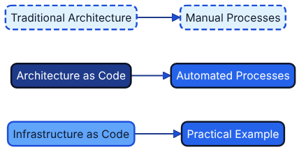
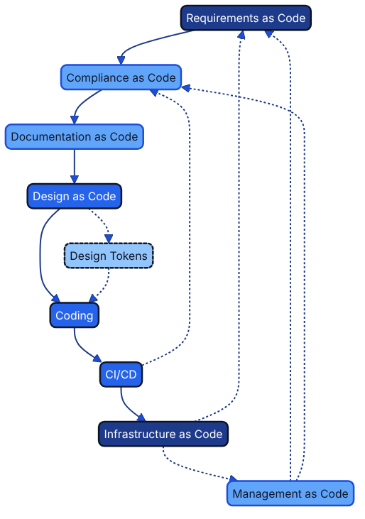

# Introduction to Architecture as Code {#introduction}

Architecture as Code represents a paradigm shift in system development where the entire system architecture is defined, version-controlled, and managed through code. This approach enables organisations to apply the same methodologies as traditional software development across their whole technical landscape.

The diagram illustrates the evolution from manual processes to the comprehensive vision of Architecture as Code, where every aspect of the system architecture is codified.

## Evolution towards Architecture as Code

Traditional methods for system architecture have often been manual and document-based. Architecture as Code builds on established principles from software development and applies them to the complete system landscape.

This includes not only infrastructure components, but also application architecture, data flows, security policies, compliance rules, and organisational structures – all expressed as code.

## Microservice complexity as the primary driver

The tipping point for most organisations adopting Architecture as Code is the complexity created by large-scale microservice estates. The *State of Cloud Native Development Q3 2025* report, produced by SlashData for the Cloud Native Computing Foundation ([Source [7]](33_references.md#source-7)), finds that 46 per cent of backend developers work with microservices and 27 per cent with event-driven architecture—a large population coordinating distributed services and asynchronous workloads at the same time. Each additional service introduces new APIs, contracts, and deployment topologies that quickly outpace what static diagrams or isolated configuration repositories can keep synchronised.

Architecture as Code counters that systemic complexity by capturing service boundaries, operational dependencies, security policies, and resilience patterns as executable artefacts. When those definitions travel through the same pipelines as application code, teams can guarantee that mesh rules, policy guardrails, and interoperability tests evolve in lockstep with every service. In practice this makes Architecture as Code the governing layer that keeps sprawling microservice portfolios coherent, observable, and compliant.

## Definition and Scope

Architecture as Code is the practice of describing, version-controlling, and automating the entire system architecture through machine-readable code. The discipline produces *live, executable specifications* that stay synchronised with the running estate rather than lingering as aspirational design artefacts, and it encompasses application components, integration patterns, data architecture, infrastructure, and organisational processes. The FINOS Common Architecture Language Model (CALM) ([Source [1]](33_references.md#source-1)) illustrates the direction of travel: an open specification that expresses software architecture in a standardised, version-controlled, machine-readable format so that it can be validated, visualised, and documented directly from the delivery pipeline.

This holistic approach enables end-to-end automation, where changes in requirements automatically propagate throughout the architecture – from application logic to deployment and monitoring. Because the specifications remain executable, governance controls, quality gates, and audit evidence can be embedded directly into the same pipelines that deliver software, keeping architecture intent verifiable at the pace that continuous delivery demands.

## Critique of Traditional Architecture

Traditional architecture practices have struggled with "slideware syndrome"—expansive decks, static diagrams, and committee reviews that rapidly drift away from operational reality. As environments evolve, these unchecked artefacts accumulate architectural entropy: the gradual loss of coherence between documented intent and implemented systems. This entropy erodes trust, leaving teams to improvise workarounds that bypass architectural guardrails altogether.

DevOps-driven change velocity amplifies these failure modes. Release pipelines ship features and infrastructure updates in hours rather than quarters, and manual governance checkpoints become bottlenecks that teams either circumvent or replicate inconsistently. Architecture as Code responds by embedding governance policies, compliance checks, and architectural decision records inside the same automated workflows, ensuring that fast-moving delivery remains accountable to shared standards without reverting to bureaucratic overhead.

Three design criteria—adoptability, extensibility, and productivity—shape how this book evaluates Architecture as Code practices and tooling.

### Adoptability

Architecture as Code succeeds only when teams can adopt it without wholesale tooling upheaval. Expressing architectural intent as YAML, JSON, or domain-specific languages keeps specifications approachable so enterprise architects, platform engineers, and governance specialists can all work in the same repository from day one. Lightweight guardrails, documented contribution paths, and iterative enablement make the practice consumable for organisations that are still shifting away from slideware-heavy governance.

### Extensibility

Extensibility is the safeguard against future bottlenecks. Modular model definitions, reusable policy templates, and integration points for build, security, and observability tooling allow an Architecture as Code platform to evolve alongside the wider landscape. Extensible artefacts give teams freedom to plug in new delivery pipelines, compliance checks, or visualisation tools without rewriting the architectural source of truth.

### Productivity

Productivity is the direct outcome of codifying architecture. Once architectural definitions, policies, and documentation live in version control, automation can validate changes, orchestrate reviews, and publish documentation without manual intervention. The result is faster feedback for architects and delivery teams, fewer approval bottlenecks, and a measurable uplift in how quickly organisations can make safe architectural decisions.

## The Interconnected Flow of Architecture as Code

Architecture as Code is not a linear process but an interconnected ecosystem where different aspects reinforce and validate each other. The diagram illustrates how various “as Code” practices form a cohesive development cycle:

**Requirements as Code** forms the foundation, with business and functional requirements codified in machine-readable formats. These requirements feed into **Compliance as Code**, ensuring that regulatory and security policies are automatically validated throughout the development process.

**Documentation as Code** maintains living documentation that evolves with the codebase, while **Design as Code** (including design tokens for consistent styling and branding) defines the visual and structural patterns. This flows naturally into the **Coding** phase, followed by **CI/CD** pipelines that automate testing, validation, and deployment.

Finally, **Infrastructure as Code**—the automated approach of managing and provisioning infrastructure through configuration files rather than manual processes ([Source [29]](33_references.md#source-29))—provisions and manages the runtime environment. **Management as Code** integrates leadership practices, governance routines, and strategic decision-making into the same version-controlled ecosystem, ensuring that organisational policies and management intent are codified alongside technical implementations. The feedback loops show how infrastructure changes can trigger compliance checks, how management policies inform requirements and compliance, and how CI/CD results inform requirements validation, creating a continuous improvement cycle that spans both technical and organisational domains.

## Purpose and Target Audience of the Book

This book is aimed at system architects, developers, project managers, and IT decision-makers who want to understand and implement Architecture as Code within their organisations.

Readers will gain comprehensive knowledge of how the entire system architecture can be codified, from foundational principles to advanced architectural patterns that encompass an organisation’s entire digital ecosystem.

## How This Book Is Organised

This book follows a deliberate progression that mirrors the typical Architecture as Code transformation journey:

**Part A: Foundations** establishes the conceptual groundwork, covering this introduction, a readiness guide for assessing organisational prerequisites (Chapter 26A), core principles, version control practices, and Architecture Decision Records that form the bedrock of successful implementation.

**Part B: Architecture Platform** explores the technical building blocks—automation, DevOps, CI/CD pipelines, and containerisation—that transform architectural intent into operational reality.

**Part C: Security, Governance and Assurance** addresses the critical controls, compliance frameworks, and evidence-as-code practices that ensure Architecture as Code practices align with regulatory requirements and organisational policies.

**Part D: Delivery and Operations** bridges technical capabilities with business outcomes through testing strategies, practical implementation patterns, cost optimisation, and migration approaches.

**Part E: Organisation and Leadership** examines the organisational transformation, team structures, cultural shifts, and leadership practices that enable sustainable Architecture as Code adoption, including the interplay between the soft "as Code" disciplines, AI agent teams, and digitalisation through code-based infrastructure.

**Part F: Experience and Best Practices** contrasts Documentation as Code with Architecture as Code and synthesises lessons learned from real-world implementations, distilling proven patterns across diverse contexts.

**Part G: Future and Wrap-up** looks ahead to emerging trends, catalogues the anti-patterns that derail Architecture as Code programmes, and provides a comprehensive conclusion that ties together all elements of the Architecture as Code journey.

The appendices (Part H) supply a glossary, the code examples referenced throughout the chapters, the technical architecture of the book's own production pipeline, the FINOS project blueprint, templates and tools, and the complete bibliography.

Each part builds upon previous foundations whilst setting the stage for what follows, creating a cohesive narrative that guides readers from first principles through to advanced practice.

## Companion workbook and course alignment

The *Architecture as Code* course workbook, exercise guide, and facilitator materials in `course/` extend this book into a practised learning journey. Each module maps directly to the chapters referenced throughout this introduction, ensuring that participants reinforce the concepts, controls, and cultural shifts described in the text. Workbook templates prompt teams to cite the relevant chapters, appendices, and evidence patterns so that classroom outputs remain consistent with the canonical guidance presented here. Facilitators should encourage learners to keep the workbook and this book side by side: every experiment, radar update, and artefact submission ought to reference the sections that informed the work, maintaining a verifiable audit trail between theory and practice.

## Looking Ahead

Architecture as Code is more than a tooling choice — it is a governing discipline that unifies design intent, delivery automation, and operational accountability into a single, version-controlled artefact. The core claim running through this book is that when architectural specifications become executable, governance becomes continuous rather than periodic, and the distance between intent and implementation collapses. By treating architecture with the same rigour as application code—the rigour that Martin (2017) [Source [33]](33_references.md#source-33) argues software structure and boundaries deserve—organisations gain the transparency, traceability, and speed that modern digital delivery demands without sacrificing the oversight that regulated and complex environments require.

Part A of this book lays the conceptual foundations for that discipline. Chapter 26A, placed directly after this introduction as a readiness guide, helps organisations assess whether their culture, technical maturity, and funding models can sustain the practice. Chapter 2 introduces the fundamental principles of Architecture as Code — declarative definitions, immutable patterns, testability, and documentation as code — explaining why each principle is essential for sustainable adoption. Chapter 3 then examines version control practices tailored to architecture assets, including repository topology, branching strategies, and the governance disciplines that keep architectural intent distinct from implementation detail. Chapter 4 explores Architecture Decision Records as the mechanism that keeps design rationale visible and auditable across the full lifecycle of a system.

## Sources

1. **FINOS.** *Architecture as Code: What is CALM?* FINOS Architecture as Code project (accessed 2026-10-30). Available at: [https://calm.finos.org/](https://calm.finos.org/). [Source [1]](33_references.md#source-1)
2. **SlashData for the Cloud Native Computing Foundation (2025).** *State of Cloud Native Development Q3 2025.* CNCF, November 2025. Available at: [https://www.cncf.io/reports/state-of-cloud-native-development/](https://www.cncf.io/reports/state-of-cloud-native-development/). [Source [7]](33_references.md#source-7)
3. **Martin, R. C. (2017).** *Clean Architecture: A Craftsman's Guide to Software Structure and Design.* Prentice Hall (Pearson). ISBN 978-0-13-449416-6. [Source [33]](33_references.md#source-33)
4. **Red Hat.** *What is Infrastructure as Code (IaC)?* Red Hat Topics (accessed 2026-10-30). Available at: [https://www.redhat.com/en/topics/automation/what-is-infrastructure-as-code-iac](https://www.redhat.com/en/topics/automation/what-is-infrastructure-as-code-iac). [Source [29]](33_references.md#source-29)
