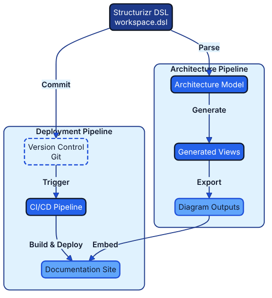

# Structurizr: Architecture Modelling as Code {#structurizr}



*Structurizr enables architects to express system architecture through code using the C4 model, creating maintainable, version-controlled architecture diagrams that evolve alongside the systems they describe.*

## Introduction

Structurizr is a collection of tooling that enables software architecture to be defined as code using the C4 model (Context, Containers, Components, and Code). Created by Simon Brown, Structurizr addresses the fundamental challenge of keeping architecture documentation synchronised with reality by treating diagrams and models as artefacts generated from a single source of truth.

In the Architecture as Code ecosystem, Structurizr serves as a practical implementation tool that allows teams to:

- Define architecture models programmatically using a domain-specific language (DSL)
- Generate multiple diagram views from a single model
- Version control architecture definitions alongside application code
- Automate architecture documentation in CI/CD pipelines
- Maintain consistency across different architectural views

The FINOS Architecture as Code project offers a complementary example: its Common Architecture Language Model (CALM) is an open-source specification for describing software architectures in a standardised, version-controlled, machine-readable JSON format, with a CLI that validates architectures and renders visualisations and documentation straight from CI/CD pipelines [Source [1]](33_references.md#source-1); the specification and its tooling are developed in the open on GitHub [Source [48]](33_references.md#source-48). CALM demonstrates how DSL-driven approaches like Structurizr stay adaptable—teams can add validators, generators, or documentation exporters around the same architecture source of truth whilst tailoring outputs to their needs.

This chapter explores how to use Structurizr for creating, developing, and handling architecture models, integrating them into modern development workflows, and establishing architecture as a living, evolving artefact.

## The C4 Model Foundation

Before diving into Structurizr itself, understanding the C4 model is essential as it forms the conceptual foundation for all Structurizr work.

### Four Levels of Abstraction

The C4 model provides a hierarchical approach to software architecture diagrams, organised across four levels:

| Level | Purpose | Audience | Abstraction |
|-------|---------|----------|-------------|
| **System Context** | Illustrates how the software system in scope fits into its environment, highlighting users and neighbouring systems | Technical and non-technical stakeholders | People and software systems |
| **Container** | Zooms into the software system to show the high-level technology building blocks and how they collaborate | Architects, developers, and operations teams | Containers, data stores, and their responsibilities |
| **Component** | Decomposes a container to explain the components that fulfil its responsibilities and how they interact | Architects and developers | Components within a container |
| **Code** | Provides an optional view of how a component is implemented in code, such as classes, interfaces, or functions | Developers | Source code structures |

Brown's C4 Model guidance stresses that each successive level narrows the audience and scope so stakeholders can reason about the system using diagrams tailored to the detail they need, keeping the hierarchy consistent across teams [Source [37]](33_references.md#source-37). The model grew out of Brown's work on lightweight, developer-friendly architecture documentation, set out in *Software Architecture for Developers* [Source [60]](33_references.md#source-60).

### Why C4 Works with Architecture as Code

The C4 model aligns naturally with Architecture as Code principles because:

1. **Hierarchical decomposition** - Different stakeholders can view the architecture at appropriate levels of detail
2. **Technology agnostic** - The model works regardless of programming languages or platforms
3. **Lightweight** - Simple notation reduces cognitive overhead
4. **Composable** - Views can be generated programmatically from a single model

### Preventing diagram decay with automation

Diagram decay—the gradual divergence between architecture diagrams and the systems they represent when updates rely on manual effort—is the problem that model-based tooling sets out to solve; the Thoughtworks Technology Radar placed "diagrams as code" in Trial in October 2020 for the same reason, naming the Structurizr DSL among the tools [Source [40]](33_references.md#source-40). Structurizr's automated generation of C4 diagrams from a single, version-controlled model eliminates that manual gap: every change to the model regenerates the diagrams for the appropriate audience, whether leadership needs the System Context view or developers need Component detail. Embedding Structurizr rendering in CI pipelines, alongside Architecture as Code validation, ensures diagrams are rebuilt with each merge so teams catch drift early rather than allowing stale visuals to persist.

## Structurizr DSL: Core Concepts

The Structurizr DSL (Domain-Specific Language) provides a text-based syntax for defining architecture models. Unlike graphical tools, the DSL approach enables version control, code review, and automation; the language reference documents every keyword used in this chapter [Source [38]](33_references.md#source-38).

### Basic Workspace Structure

Every Structurizr model begins with a workspace definition:

```structurizr
workspace "Architecture as Code Example" "Example architecture for demonstrating Structurizr" {

    model {
        # Define people, software systems, containers, and components here
    }

    views {
        # Define which diagrams to generate from the model
    }
    
    configuration {
        # Optional styling and rendering settings
    }
}
```

### Defining Model Elements

#### People and Software Systems

```structurizr
workspace "E-Commerce Platform" {

    model {
        # People (actors)
        customer = person "Customer" "A person who purchases products from the platform"
        admin = person "Administrator" "Internal staff managing the platform"
        
        # Software Systems
        ecommerce = softwareSystem "E-Commerce Platform" "Enables customers to browse and purchase products" {
            # This is the system we're building
        }
        
        paymentGateway = softwareSystem "Payment Gateway" "Third-party payment processing" {
            tags "External System"
        }
        
        # Relationships
        customer -> ecommerce "Browses products, places orders"
        ecommerce -> paymentGateway "Processes payments using"
        admin -> ecommerce "Manages products and orders using"
    }
    
    views {
        systemContext ecommerce "SystemContext" {
            include *
            autoLayout
        }
    }
}
```

This simple example creates a System Context diagram showing how users and external systems interact with the e-commerce platform.

#### Containers

Containers represent deployable units like web applications, mobile apps, databases, or microservices:

```structurizr
ecommerce = softwareSystem "E-Commerce Platform" {
    
    webApp = container "Web Application" "Delivers content to customer browsers" "React" {
        tags "Web"
    }
    
    apiGateway = container "API Gateway" "Provides API to web and mobile clients" "Node.js, Express" {
        tags "API"
    }
    
    orderService = container "Order Service" "Manages order lifecycle" "Java, Spring Boot" {
        tags "Microservice"
    }
    
    productService = container "Product Service" "Manages product catalog" "Python, FastAPI" {
        tags "Microservice"
    }
    
    database = container "Database" "Stores product and order data" "PostgreSQL" {
        tags "Database"
    }
    
    # Container relationships
    customer -> webApp "Browses products and places orders using" "HTTPS"
    webApp -> apiGateway "Makes API calls to" "HTTPS/JSON"
    apiGateway -> orderService "Routes requests to" "gRPC"
    apiGateway -> productService "Routes requests to" "REST/JSON"
    orderService -> database "Reads from and writes to" "JDBC"
    orderService -> paymentGateway "Processes payments using" "HTTPS/REST"
    productService -> database "Reads from and writes to" "SQLAlchemy"
}
```

#### Components

Components represent logical building blocks within containers:

```structurizr
orderService = container "Order Service" {
    
    orderController = component "Order Controller" "Handles HTTP requests for orders" "Spring MVC Controller"
    orderRepository = component "Order Repository" "Provides access to order data" "Spring Data JPA"
    paymentClient = component "Payment Client" "Integrates with payment gateway" "REST Client"
    emailService = component "Email Service" "Sends order confirmation emails" "Spring Mail"
    
    # Component relationships
    orderController -> orderRepository "Uses"
    orderController -> paymentClient "Uses"
    orderController -> emailService "Uses"
    orderRepository -> database "Reads/writes data" "JDBC"
}
```

### Creating Views

Deployment views need a deployment environment, which belongs in the model rather than in the views block: deployment nodes, and the container instances running on them, are declared under `deploymentEnvironment` [Source [38]](33_references.md#source-38).

```structurizr
model {
    # ... people, software systems and containers as defined above

    production = deploymentEnvironment "Production" {
        deploymentNode "Customer Device" "" "Web browser" {
            containerInstance webApp
        }

        deploymentNode "AWS Cloud" {
            deploymentNode "ECS Cluster" "" "Amazon ECS" {
                containerInstance apiGateway
                containerInstance orderService
                containerInstance productService
            }

            deploymentNode "RDS" "" "Amazon RDS for PostgreSQL" {
                containerInstance database
            }
        }
    }
}
```

Views then define which diagrams Structurizr should generate from the model. A dynamic view may only show relationships that exist in the static model, and a deployment view refers to the environment by its identifier:

```structurizr
views {
    # System Context diagram
    systemContext ecommerce "SystemContext" {
        include *
        autoLayout lr
    }
    
    # Container diagram
    container ecommerce "Containers" {
        include *
        autoLayout
    }
    
    # Component diagram for specific container
    component orderService "OrderServiceComponents" {
        include *
        autoLayout
    }
    
    # Dynamic diagram showing interaction sequence
    dynamic ecommerce "OrderPlacement" "Order placement flow" {
        customer -> webApp "Places order"
        webApp -> apiGateway "POST /api/orders"
        apiGateway -> orderService "CreateOrder()"
        orderService -> paymentGateway "ProcessPayment()"
        orderService -> database "SaveOrder()"
        autoLayout
    }
    
    # Deployment diagram for the "production" environment defined in the model
    deployment ecommerce production "DeploymentProduction" {
        include *
        autoLayout
    }
}
```

### Styling and Themes

Structurizr allows customisation of diagram appearance:

```structurizr
views {
    styles {
        element "Person" {
            shape person
            background #08427b
            colour #ffffff
        }
        
        element "Software System" {
            background #1168bd
            colour #ffffff
        }
        
        element "External System" {
            background #999999
            colour #ffffff
        }
        
        element "Container" {
            background #438dd5
            colour #ffffff
        }
        
        element "Component" {
            background #85bbf0
            colour #000000
        }
        
        element "Database" {
            shape cylinder
        }
        
        relationship "Relationship" {
            routing orthogonal
            thickness 2
        }
    }
    
    themes https://static.structurizr.com/themes/default/theme.json
}
```

## Workspace Configuration and Management

### Workspace Types

Structurizr is distributed as a single application—the `structurizr/structurizr` Docker image or the `structurizr.war` Java archive—whose commands cover three ways of working [Source [61]](33_references.md#source-61):

1. **`local`** - Free and open source. Views diagrams and lets you modify their layout on your own machine, reachable only through `localhost` URLs; it replaces Structurizr Lite.
2. **`server`** - A self-hosted server for publishing workspaces to a wider audience. The open core is free when built from source, while the prebuilt binaries add enterprise features and require a licence; it replaces the on-premises installation.
3. **`export`** - Free and open source. Exports the views in a workspace to PlantUML, Mermaid, WebSequenceDiagrams, Structurizr JSON or a static HTML site, with PNG and SVG rendering available where the Playwright dependencies are installed [Source [63]](33_references.md#source-63).

Structurizr Lite, the standalone Structurizr CLI and the Structurizr cloud service have all reached end of life and no longer receive updates [Source [62]](33_references.md#source-62); the examples in this chapter therefore use only the consolidated tooling.

### Using `local` for Development

`local` is ideal for day-to-day modelling: it reads `workspace.dsl` from the directory you mount and shows your changes when you refresh the browser [Source [65]](33_references.md#source-65):

```bash
# Start Structurizr local with the pre-built Docker image
docker run -it --rm -p 8080:8080 \
  -v $(pwd)/workspace:/usr/local/structurizr \
  structurizr/structurizr local
```

This launches a local web server on `http://localhost:8080` where you can view diagrams generated from your DSL files and adjust their layout in the diagram editor; no account or hosted service is required. Layout changes are saved to a `workspace.json` file next to the DSL, which is why both files belong in version control [Source [66]](33_references.md#source-66).

### File Organisation

Organise Structurizr files alongside your codebase:

```text
project/
├── docs/
│   └── architecture/
│       ├── workspace.dsl          # Main architecture definition
│       ├── views/                 # Exported diagrams (PNG, SVG)
│       └── README.md              # Architecture documentation
├── src/                           # Application source code
└── .github/
    └── workflows/
        └── architecture-docs.yml  # CI/CD for architecture
```

### Multi-File Workspaces

For large projects, split the model across multiple files:

```structurizr
# workspace.dsl
workspace "Large System" {
    !docs docs
    !adrs adrs
    
    model {
        !include model/people.dsl
        !include model/systems.dsl
        !include model/containers.dsl
    }
    
    views {
        !include views/system-context.dsl
        !include views/containers.dsl
        !include views/deployment.dsl
        
        !include views/styles.dsl
    }
}
```

```structurizr
# model/people.dsl
customer = person "Customer"
admin = person "Administrator"
support = person "Support Agent"
```

```structurizr
# model/systems.dsl
mainSystem = softwareSystem "Main System" {
    !include containers/web-app.dsl
    !include containers/api-gateway.dsl
    !include containers/services.dsl
}

externalPayment = softwareSystem "Payment Provider" {
    tags "External"
}
```

### Governance Patterns for Enterprise Workspaces

Sustaining expansive workspaces demands routine guardrails so that dozens of contributors can evolve diagrams without introducing drift. The following sequence keeps Structurizr DSL repositories predictable and reviewable:

1. **Define a domain folder structure** – Create `model/domains/<domain>.dsl` files for each major capability (for example, `payments.dsl`, `catalogue.dsl`, `governance.dsl`). These files declare people, software systems, and containers that belong to the same functional area.
2. **Aggregate with intent-revealing include files** – Introduce thin aggregators such as `model/core.dsl` or `model/external.dsl` that simply list `!include` statements. The main workspace file then references the aggregators, keeping the top-level `model {}` block short and navigable, as demonstrated in the Structurizr DSL language reference [Source [38]](33_references.md#source-38).
3. **Enforce naming conventions centrally** – Store canonical tags and naming prefixes in `configuration { properties { ... } }` and shared include files. For instance, prefix container identifiers with their bounded context (e.g. `payments_api`) and suffix view keys with the chapter number (`PaymentsContainers06`). Reviewers can spot deviations instantly because every file uses the same include.
4. **Document relationship expectations** – Maintain a `docs/STRUCTURIZR_GUIDELINES.md` (or similar) that states how to phrase relationship descriptions (“uses”, “publishes events to”, “reads from”). Link the document from pull request templates so contributors confirm adherence before review.
5. **Leverage `local` for validation** – Encourage contributors to load the workspace with [`structurizr local`](https://docs.structurizr.com/local) during development. It persists layout updates in `workspace.json` alongside the DSL, enabling contributors to visualise convention breaches before they reach code review.

These steps modularise the workspace whilst making naming policies transparent, preventing accidental duplication of actors or services when multiple programmes collaborate.

### Automated Layout Templates, Quality Gates, and Versioning

Automation protects diagram fidelity and keeps layout choices consistent as models expand. Combine DSL includes with scripted `structurizr export` runs to enforce standards:

- **Reusable layout templates** – Extract shared layout instructions into dedicated files and include them in every view. For example:

  ```structurizr
  # views/layouts/standard-container-layout.dsl
  # autoLayout <tb|bt|lr|rl> [rankSeparation] [nodeSeparation], separations in pixels
  autoLayout lr 450 350
  ```

  ```structurizr
  container ecommerce "Containers" {
      include *
      !include views/layouts/standard-container-layout.dsl
  }
  ```

  Every view inherits the same orientation and spacing without relying on manual dragging in the editor. Paper size and other presentation settings are not DSL keywords; they are chosen in the `local` or `server` diagram editor and stored in `workspace.json` [Source [38]](33_references.md#source-38).

- **Quality gates in CI/CD** – Add a lightweight shell script to fail builds when conventions slip:

  ```bash
  #!/usr/bin/env bash
  set -euo pipefail

  workspace="docs/architecture/workspace.dsl"
  output_dir="build/structurizr"

  # Use the Java archive directly, or swap in the Docker image:
  # docker run --rm -v "$PWD":/usr/local/structurizr structurizr/structurizr
  structurizr="java -jar structurizr.war"

  $structurizr validate -workspace "$workspace"
  $structurizr export -workspace "$workspace" -format json -output "$output_dir"

  # Containers sit under model.softwareSystems[].containers[] in the JSON export;
  # require at least one container and check every name against the convention.
  jq -e '[.model.softwareSystems[]?.containers[]?.name]
         | length > 0 and all(test("^[A-Z][A-Za-z]+( [A-Z][A-Za-z]+)* API$"))' \
    "$output_dir/workspace.json"
  ```

  The example checks that container names end with “API” and start with capitalised words; adapt the regular expression to your organisation. Additional `jq` queries can assert that required tags or documentation URLs are present before the pipeline marks the change as ready.

- **Diagram versioning** – Commit the `workspace.json` that `local` or `server` saves alongside the DSL to preserve layout history. The DSL holds the model and view definitions, while the JSON holds the manual layout, so a `git diff` on the JSON highlights when an element moves or a layout template changes [Source [66]](33_references.md#source-66). Tying the JSON revision to release tags gives architecture reviewers a linear history of diagram evolution that complements the DSL blend of automation and narrative.

These automation techniques build upon the enablement practices described later in Chapter 24, letting platform engineers execute Chapter 06 guidance through reproducible tooling.

### Team Enablement and Adoption Playbook

Scaling Structurizr beyond a single maintainer requires deliberate enablement so that architecture automation becomes a shared capability rather than a heroic effort. Combine the following rhythms with the people-development patterns in Chapter 24 to spread ownership:

1. **Foundational bootcamps** – Run a recurring two-hour workshop that walks through the reference workspace, highlights the module structure described above, and demonstrates how `local` and the `export` command complement one another. Recording each session helps global teams revisit the material asynchronously.
2. **Pair-modelling rotations** – Assign monthly pairs that include one experienced maintainer and one new contributor. Each pair triages backlog items, applies naming policies, and raises any missing automation hooks. Rotations prevent tacit knowledge from concentrating in a single geography or department.
3. **Checklists in pull request templates** – Extend pull request templates with explicit Structurizr checks ("Ran `./scripts/render_structurizr_diagrams.sh`, updated layout template includes, attached before/after screenshots from `local`"). Contributors self-attest to these tasks, and reviewers can focus on architectural intent instead of procedural reminders.
4. **Capability metrics** – Track lead time for diagram updates, the number of contributors editing the workspace each quarter, and the percentage of views using the shared layout templates. Publish these metrics alongside the broader enablement dashboards introduced in Chapter 24 to spotlight where additional coaching is required.
5. **Community of practice** – Host a monthly forum where teams share lessons, propose adjustments to the naming conventions, and experiment with new Structurizr DSL features referenced in the official documentation. Capture agreed changes in the guidelines repository so the knowledge persists beyond the meeting.

This cadence keeps Structurizr maintainers embedded within a wider community, reducing the risk of bottlenecks and reinforcing the book’s emphasis on collaborative architecture stewardship.

## Reference Workspace for Architecture Teams

To accelerate onboarding, the repository now ships with a curated Structurizr workspace that mirrors the C4 abstractions described throughout this chapter. You can find the canonical definition in `docs/examples/structurizr/aac_reference_workspace.dsl`, with supporting guidance in `docs/examples/structurizr/README.md`.

### Repository artefacts

- **Workspace DSL** – Implements System Context, Container, Component, Dynamic, and Deployment views for the Architecture as Code platform, providing a ready-made baseline for teams to copy or extend.
- **Styling conventions** – Applies consistent British English tagging and a colour palette that emphasises governance, automation, and telemetry pathways referenced in the book.
- **Configuration metadata** – Records, as a free-form workspace property, the Structurizr release with which the exports were last generated; the render script pins the container image itself, so the property documents the toolchain rather than enforcing it.
- **Decision catalogue** – Stores ADR markdown files in `docs/examples/structurizr/adrs/` and links them directly from containers and components so reviewers can open the governing decision without leaving the diagram.
- **Workspace manifest** – Captures a SHA-256 digest and export metadata in `aac_reference_workspace.manifest.json`, allowing automation to detect when the DSL changes without updated exports.

### Exploring the reference workspace

Follow these steps to render the workspace locally:

1. Install Docker or Podman; the helper pulls the `structurizr/structurizr` image (release `2026.09.19`), the consolidated distribution that replaced the standalone CLI [Source [64]](33_references.md#source-64).
2. Execute the helper that mirrors the CI workflow:
   ```bash
   ./scripts/render_structurizr_diagrams.sh
   ```
   The script validates the workspace, exports Structurizr JSON and PlantUML files into `build/structurizr/`, and refreshes the manifest hash. When Docker or Podman is unavailable it prints equivalent `java -jar structurizr.war` commands so contributors can still regenerate diagrams manually.
3. Render the PlantUML files with PlantUML, or copy the DSL into a directory as `workspace.dsl` and start `structurizr local` there to explore the interactive views.

These commands align with the automation demonstrated earlier in this chapter, ensuring that developers, architects, and editors can iterate confidently without bespoke tooling. Commit the updated `aac_reference_workspace.manifest.json` whenever the DSL changes so the automation pipeline recognises that exports remain in sync.

### Contribution workflow for diagram updates

A consistent contribution workflow prevents diagram drift and preserves traceability across programmes:

1. **Create a feature branch** – Prefix it with `structurizr/` to signal architecture-oriented work.
2. **Amend the DSL** – Update `aac_reference_workspace.dsl` or add modular `!include` files in the same directory. Each change should retain the C4 hierarchy and respect agreed tags.
3. **Validate locally** – Run `./scripts/render_structurizr_diagrams.sh` so validation, exports, and the manifest update all mirror CI behaviour. Address any reported warnings before requesting review.
4. **Document intent** – Capture the architectural rationale in the pull request description and, where relevant, reference related Architecture Decision Records.
5. **Run the book build** – `python3 generate_book.py && docs/build_book.sh` ensures that downstream artefacts (including PNG diagrams referenced in the manuscript) remain in sync.
6. **Request dual review** – Tag at least one platform engineer and one product architect so that automation and domain perspectives both evaluate the change.
7. **Check automation outcomes** – Confirm that GitHub Actions architecture checks and the main book build succeed before merging.

By following these steps, teams maintain a shared, version-controlled architecture narrative that evolves alongside the software delivery platform.

## Integration with CI/CD Pipelines

Automating architecture documentation ensures diagrams stay synchronised with code changes. The repository ships with `.github/workflows/structurizr-diagrams.yml`; the abridged version below shows the tasks it performs on every pull request that touches the Structurizr workspace or helper scripts:

```yaml
name: Structurizr diagram automation

on:
  pull_request:
    paths:
      - 'docs/examples/structurizr/**'
      - 'scripts/render_structurizr_diagrams.sh'
      - 'scripts/update_structurizr_manifest.py'
      - 'scripts/check_structurizr_manifest.py'

jobs:
  validate:
    runs-on: ubuntu-latest
    steps:
      - uses: actions/checkout@v4
      - name: Render Structurizr diagrams
        env:
          STRUCTURIZR_SKIP_MANIFEST_UPDATE: "1"
        run: ./scripts/render_structurizr_diagrams.sh
      - name: Upload Structurizr artefacts
        if: ${{ always() && hashFiles('build/structurizr/**') != '' }}
        uses: actions/upload-artifact@v4
        with:
          name: structurizr-diagrams
          path: build/structurizr
      - name: Enforce manifest alignment
        run: python3 scripts/check_structurizr_manifest.py
```

The workflow mirrors the local helper by exporting Structurizr JSON and PlantUML files whilst skipping the manifest update to avoid masking drift. The final `check_structurizr_manifest.py` invocation compares the committed digest with the current DSL and fails the build when contributors forget to refresh the manifest. Reviewers still receive fresh diagrams via the uploaded artefact, satisfying the pipeline requirements without sacrificing fast feedback.

### GitHub Actions Example

```yaml
name: Architecture Documentation

on:
  push:
    branches: [main]
    paths:
      - 'docs/architecture/**'
      - 'src/**'
  pull_request:
    paths:
      - 'docs/architecture/**'

jobs:
  generate-diagrams:
    runs-on: ubuntu-latest
    
    steps:
      - uses: actions/checkout@v7

      # The consolidated structurizr/structurizr image mounts the checkout as its
      # working directory, so workspace paths can stay relative.
      - name: Validate Structurizr DSL
        run: |
          docker run --rm -v "$PWD":/usr/local/structurizr \
            structurizr/structurizr:2026.09.19 validate -workspace docs/architecture/workspace.dsl

      - name: Export diagrams to PlantUML
        run: |
          docker run --rm -v "$PWD":/usr/local/structurizr \
            structurizr/structurizr:2026.09.19 export -workspace docs/architecture/workspace.dsl \
            -format plantuml -output docs/architecture/views

      # Run PlantUML from a shell step: a docker:// action passes args straight to the
      # container entrypoint, so $(pwd) and globs would not be expanded there.
      - name: Render PNG from PlantUML
        run: |
          docker run --rm -v "$PWD":/data plantuml/plantuml:latest \
            -tpng -o /data/docs/architecture/views /data/docs/architecture/views

      - name: Commit Updated Diagrams
        if: github.ref == 'refs/heads/main'
        run: |
          git config user.name "Architecture Bot"
          git config user.email "architecture@example.com"
          git add docs/architecture/views/*.png
          git diff --quiet && git diff --staged --quiet || \
            git commit -m "Update architecture diagrams [skip ci]"
          git push
```

> **Security and workflow warning:** The default `GITHUB_TOKEN` cannot push to protected branches without explicit write permissions granted in the workflow permissions block. Auto-committing directly to `main` also risks recursive workflow triggers — whilst `[skip ci]` in the commit message suppresses re-runs, it may bypass mandatory status checks required by branch protection rules and should be used with caution. The preferred, safer approach is to use the `actions/upload-artifact` pattern (shown later in this chapter), which publishes generated diagrams as workflow artefacts without modifying the repository during CI. Reserve auto-commit patterns for unprotected branches or use a dedicated bot token with appropriately scoped permissions.

### GitLab CI Example

```yaml
architecture-documentation:
  image:
    name: structurizr/structurizr:2026.09.19-noble
    # GitLab runs the script through its own shell, so clear the image entrypoint
    # and call the Structurizr launcher (or java -jar /usr/local/structurizr.war) explicitly.
    entrypoint: [""]
  stage: documentation
  script:
    - /usr/local/structurizr.sh validate -workspace docs/architecture/workspace.dsl
    - /usr/local/structurizr.sh export -workspace docs/architecture/workspace.dsl -format plantuml -output output/
  artifacts:
    paths:
      - output/
  rules:
    - changes:
        - docs/architecture/**/*
        - src/**/*
```

### Validation in Pull Requests

Prevent architecture drift by validating changes:

```yaml
name: Architecture Validation

on:
  pull_request:
    paths:
      - 'docs/architecture/**'

jobs:
  validate:
    runs-on: ubuntu-latest
    steps:
      - uses: actions/checkout@v7
      
      - name: Validate DSL Syntax
        run: |
          docker run --rm -v "$PWD":/usr/local/structurizr \
            structurizr/structurizr:2026.09.19 validate -workspace docs/architecture/workspace.dsl
      
      - name: Check for Undocumented Components
        run: |
          # Custom script to verify all services have architecture representation
          python scripts/validate-architecture-coverage.py
      
      - name: Generate Diff Preview
        run: |
          # Export PlantUML for the head branch so reviewers can compare rendered diagrams
          docker run --rm -v "$PWD":/usr/local/structurizr \
            structurizr/structurizr:2026.09.19 export -workspace docs/architecture/workspace.dsl \
            -format plantuml -output preview/
```

## Practical Implementation Patterns

### Pattern 1: Microservices Architecture

```structurizr
workspace "Microservices Platform" {
    model {
        user = person "User"
        
        platform = softwareSystem "Microservices Platform" {
            
            gateway = container "API Gateway" "Routes and authenticates requests" "Kong" {
                tags "Infrastructure"
            }
            
            group "Core Services" {
                userService = container "User Service" "Manages user accounts" "Node.js"
                authService = container "Auth Service" "Handles authentication" "Node.js"
                notificationService = container "Notification Service" "Sends notifications" "Python"
            }
            
            group "Business Services" {
                orderService = container "Order Service" "Processes orders" "Java"
                inventoryService = container "Inventory Service" "Manages inventory" "Go"
                paymentService = container "Payment Service" "Processes payments" "Java"
            }
            
            group "Data Layer" {
                userDb = container "User Database" "User data" "PostgreSQL"
                orderDb = container "Order Database" "Order data" "PostgreSQL"
                inventoryDb = container "Inventory Database" "Inventory data" "MongoDB"
            }
            
            messageBus = container "Message Bus" "Async communication" "RabbitMQ" {
                tags "Infrastructure"
            }
        }
        
        # Relationships
        user -> gateway "Makes requests"
        gateway -> userService "Routes /users/*"
        gateway -> orderService "Routes /orders/*"
        gateway -> authService "Validates tokens"
        
        userService -> userDb "Reads/writes"
        orderService -> orderDb "Reads/writes"
        inventoryService -> inventoryDb "Reads/writes"
        
        orderService -> messageBus "Publishes OrderCreated"
        # Dynamic views may only reuse relationships that exist here
        messageBus -> inventoryService "Delivers OrderCreated events to"
        messageBus -> notificationService "Delivers OrderCreated events to"
        notificationService -> user "Sends order confirmations to" "E-mail"
    }
    
    views {
        container platform "MicroservicesContainer" {
            include *
            autoLayout
        }
        
        dynamic platform "OrderFlow" {
            user -> gateway "POST /orders"
            gateway -> authService "ValidateToken"
            gateway -> orderService "CreateOrder"
            orderService -> orderDb "SaveOrder"
            orderService -> messageBus "Publish OrderCreated"
            messageBus -> inventoryService "OrderCreated event"
            inventoryService -> inventoryDb "ReserveItems"
            messageBus -> notificationService "OrderCreated event"
            notificationService -> user "Send confirmation"
            autoLayout
        }
    }
}
```

### Pattern 2: Event-Driven Architecture

```structurizr
workspace "Event-Driven System" {
    model {
        producer = softwareSystem "Event Producer" "Generates domain events"
        eventStore = softwareSystem "Event Store" "Stores event stream" {
            tags "Database"
        }
        
        consumer1 = softwareSystem "Read Model Service" "Builds read models"
        consumer2 = softwareSystem "Analytics Service" "Analyzes events"
        consumer3 = softwareSystem "Notification Service" "Sends notifications"
        
        producer -> eventStore "Appends events to"
        eventStore -> consumer1 "Streams events to"
        eventStore -> consumer2 "Streams events to"
        eventStore -> consumer3 "Streams events to"
    }
    
    views {
        systemContext eventStore "EventDrivenContext" {
            include *
            autoLayout
        }
    }
}
```

### Pattern 3: Multi-Tenant SaaS

```structurizr
workspace "Multi-Tenant SaaS" {
    model {
        tenant1 = person "Tenant 1 Users"
        tenant2 = person "Tenant 2 Users"
        
        saas = softwareSystem "SaaS Platform" {
            frontend = container "Web App" "Customer interface" "React"
            
            api = container "API Layer" "Multi-tenant API" "Node.js" {
                tenantMiddleware = component "Tenant Middleware" "Identifies tenant from request"
                tenantResolver = component "Tenant Resolver" "Resolves tenant configuration"
            }
            
            # Separate schemas per tenant
            tenant1Db = container "Tenant 1 Database" "Isolated tenant data" "PostgreSQL"
            tenant2Db = container "Tenant 2 Database" "Isolated tenant data" "PostgreSQL"
            
            sharedDb = container "Shared Database" "Tenant configuration" "PostgreSQL"
        }
        
        tenant1 -> frontend "Uses"
        tenant2 -> frontend "Uses"
        frontend -> api "API calls with tenant ID"
        api -> sharedDb "Reads tenant config"
        api -> tenant1Db "Reads/writes (Tenant 1)"
        api -> tenant2Db "Reads/writes (Tenant 2)"
    }
    
    views {
        container saas "MultiTenantArchitecture" {
            include *
            autoLayout
        }
        
        component api "TenantIsolation" {
            include *
            autoLayout
        }
    }
}
```

## Advanced Features

### Include and Exclude Expressions

Show different perspectives of the same model by controlling what each view includes; the software system in scope is never itself drawn on its own container view, so expressions select its surroundings instead [Source [38]](33_references.md#source-38):

```structurizr
views {
    # External dependencies: the default elements, minus anything tagged Internal
    container platform "ExternalDependencies" {
        include *
        exclude "element.tag==Internal"
        autoLayout
    }
    
    # Security-focused view: security-tagged elements, their neighbours and the people involved
    container platform "SecurityView" {
        include "element.tag==Security"
        include "element.type==Person"
        include ->element.tag==Security->
        autoLayout
    }
}
```

Structurizr also has a dedicated `filtered` view type: a view defined on top of an existing System Landscape, System Context, Container or Component view that includes or excludes elements and relationships by tag. Once a filtered view exists, the base view no longer appears in the diagram list, so add a filtered view covering the `Element` and `Relationship` tags if you still want to see it:

```structurizr
views {
    systemLandscape "Landscape" {
        include *
        autoLayout
    }
    
    filtered "Landscape" include "Security,Relationship" "SecurityLandscape" "Security-relevant systems only"
    filtered "Landscape" exclude "Internal" "ExternalLandscape" "Everything except internal systems"
    filtered "Landscape" include "Element,Relationship" "FullLandscape" "The complete landscape"
}
```

### Model Perspectives

Add supplementary information without cluttering diagrams:

```structurizr
orderService = container "Order Service" {
    perspectives {
        "Security" "Requires JWT authentication, RBAC for order access"
        "Performance" "Target: 100ms p95 latency, 1000 req/s throughput"
        "Cost" "~$500/month in AWS (2 ECS tasks + RDS instance)"
        "Compliance" "Stores PII, requires GDPR compliance"
    }
}
```

### Documentation Sections

Embed markdown documentation within the workspace:

```structurizr
workspace {
    !docs docs
    
    model {
        # ... model definition
    }
}
```

Then create `docs/` folder with markdown files:

```text
docs/
├── 01-overview.md
├── 02-architecture-decisions.md
├── 03-deployment.md
└── 04-operations.md
```

### Architecture Decision Records (ADR) Integration

```structurizr
workspace {
    !adrs adrs
    
    model {
        # Model elements can reference ADRs
    }
}
```

Structure:

```text
adrs/
├── 0001-use-microservices.md
├── 0002-event-sourcing-for-orders.md
└── 0003-postgresql-for-primary-storage.md
```

## Best Practices

### 1. Single Source of Truth

Store the DSL file in version control alongside code:

```text
✅ Good:
repository/
├── src/
├── docs/architecture/workspace.dsl
└── README.md

❌ Bad:
- DSL in one repository, code in another
- Diagrams manually created and stored as images
```

### 2. Automate Diagram Generation

Never manually edit generated diagrams:

```yaml
# Automated
on:
  push:
    paths: ['docs/architecture/**']
jobs:
  generate:
    steps:
      - run: java -jar structurizr.war export -workspace docs/architecture/workspace.dsl -format plantuml
```

### 3. Use Meaningful Identifiers

```structurizr
# Good - clear, readable identifiers
userService = container "User Service"
orderService = container "Order Service"

# Bad - cryptic identifiers  
us = container "User Service"
os = container "Order Service"
```

### 4. Tag Strategically

Tags enable filtering and styling:

```structurizr
container "API" {
    tags "Backend" "REST API" "Critical Path"
}

container "Legacy System" {
    tags "Legacy" "Deprecated" "Scheduled for Retirement"
}
```

### 5. Keep Views Focused

```structurizr
# Good - focused view
container platform "CoreServices" {
    include "element.tag==Core"
    autoLayout
}

# Bad - everything in one view
container platform "Everything" {
    include *
    # Too cluttered to be useful
}
```

### 6. Document Relationships

```structurizr
orderService -> paymentGateway "Processes payments using" "HTTPS/REST" {
    tags "External Integration" "PCI-DSS Scope"
}
```

### 7. Use Implied Relationships

Structurizr automatically creates implied relationships:

```structurizr
# When component A -> container B, and container B belongs to system C,
# Structurizr implies: component A -> system C (at higher abstraction levels)

# This keeps models DRY while generating appropriate diagrams at each level
```

### 8. Version Control Everything

```bash
# Track all architecture artifacts
git add docs/architecture/workspace.dsl
git add docs/architecture/views/*.png
git commit -m "Add payment service to architecture model"
```

### 9. Review Architecture Changes Like Code

Require pull request reviews for architecture changes:

```yaml
# .github/CODEOWNERS
docs/architecture/** @architecture-team
```

### 10. Keep Models Synchronised

```python
# Script to verify architecture coverage
def verify_architecture_coverage():
    """Ensure all microservices are documented in Structurizr"""
    
    # Parse services from code
    actual_services = discover_services_from_code()
    
    # Parse services from Structurizr DSL
    documented_services = parse_structurizr_model()
    
    missing = actual_services - documented_services
    if missing:
        raise Exception(f"Undocumented services: {missing}")
```

## Comparison with Other Tools

### Structurizr vs. Traditional Diagramming Tools

| Aspect | Structurizr | Draw.io / Visio | Lucidchart |
|--------|-------------|-----------------|------------|
| **Version Control** | ✅ Native (text files) | ⚠️ Binary files | ⚠️ Cloud-based versioning |
| **Code Review** | ✅ Standard Git workflows | ❌ Difficult | ❌ Not supported |
| **Automation** | ✅ `export` command and workspace API | ❌ Manual | ⚠️ Limited API |
| **Single Source of Truth** | ✅ Model generates views | ❌ Each diagram separate | ❌ Each diagram separate |
| **Learning Curve** | ⚠️ Moderate (DSL syntax) | ✅ Low (drag-drop) | ✅ Low (drag-drop) |
| **Consistency** | ✅ Enforced by model | ❌ Manual effort | ❌ Manual effort |
| **Cost** | ✅ Free (`local`, `export`); licence only for prebuilt `server` binaries | ✅ Free or one-time purchase | 💰 Subscription |

### Structurizr vs. PlantUML

| Aspect | Structurizr | PlantUML |
|--------|-------------|----------|
| **Focus** | Software architecture (C4) | Various diagram types |
| **Abstraction Levels** | ✅ Built-in (C4 hierarchy) | ⚠️ Manual management |
| **Layout Control** | ⚠️ Limited (auto-layout) | ✅ More granular |
| **Model Reuse** | ✅ Single model, multiple views | ❌ Each diagram separate |
| **Syntax** | ✅ Architecture-specific DSL | ⚠️ Generic diagramming |
| **Tooling** | ✅ Dedicated tools (`local`, `server`) | ✅ Wide tool support |
| **Learning Curve** | ✅ Lower for C4 | ⚠️ Steeper syntax |

### Structurizr vs. Mermaid

| Aspect | Structurizr | Mermaid |
|--------|-------------|---------|
| **C4 Model Support** | ✅ Native, comprehensive | ⚠️ Basic C4 support |
| **Diagram Types** | Architecture-focused | Wide variety (flowcharts, etc.) |
| **GitHub Integration** | ⚠️ Requires export | ✅ Native rendering |
| **Model Consistency** | ✅ Single model enforces | ❌ Separate diagrams |
| **Interactive Viewers** | ✅ Structurizr `local`/`server` | ⚠️ Limited |
| **Documentation** | ✅ Integrated docs/ADRs | ❌ Separate |
| **Best Use Case** | Complex architecture models | Quick, simple diagrams |

### Recommendation Matrix

| Scenario | Recommended Tool | Rationale |
|----------|------------------|-----------|
| Large-scale system architecture | **Structurizr** | Model consistency, C4 hierarchy, architecture focus |
| Quick diagrams in README | **Mermaid** | GitHub native support, simple syntax |
| Detailed sequence diagrams | **PlantUML** | Rich sequence diagram features |
| Non-technical stakeholder presentations | **Lucidchart/Draw.io** | Familiar interface, easy customisation |
| Architecture as Code practice | **Structurizr** | Native version control, automation support |

## Common Challenges and Solutions

### Challenge 1: Layout Control

**Problem**: Auto-layout doesn't always produce ideal diagrams.

**Solutions**:

1. Specify the layout direction and spacing:

```structurizr
# lr = left-to-right; alternatives: tb (top-bottom), bt (bottom-top), rl (right-left)
# The optional numbers are rank and node separation in pixels (default 300)
views {
    container platform {
        include *
        autoLayout lr 300 300
    }
}
```

2. Lay out by hand where it matters. The DSL has no coordinate syntax: open the workspace with `structurizr local` (or `server`), drag the elements in the diagram editor, and commit the `workspace.json` it saves next to `workspace.dsl`. Remove `autoLayout` from the views you arrange manually, otherwise the automatic layout is reapplied every time the diagram is rendered [Source [66]](33_references.md#source-66).

3. Export to PlantUML or Mermaid for fine-tuning:

```bash
java -jar structurizr.war export -workspace workspace.dsl -format plantuml
# Then adjust the PlantUML layout directives in the generated .puml files
```

### Challenge 2: Large Models Become Complex

**Problem**: Single workspace file becomes unwieldy.

**Solution**: Split into multiple files
```structurizr
workspace {
    model {
        !include model/people.dsl
        !include model/external-systems.dsl
        !include model/platform/api-layer.dsl
        !include model/platform/services.dsl
        !include model/platform/data-layer.dsl
    }
    
    views {
        !include views/context.dsl
        !include views/containers.dsl
        !include views/components
        !include views/deployment.dsl
    }
}
```

### Challenge 3: Keeping Model Synchronised with Reality

**Problem**: Code evolves but architecture model becomes stale.

**Solution**: Automated validation
```python
# ci/validate-architecture.py
import requests
import yaml

def get_running_services():
    """Query service registry for deployed services"""
    registry = requests.get("http://service-registry/api/services")
    return {s["name"] for s in registry.json()}

def parse_structurizr_containers():
    """Extract container names from DSL"""
    with open("docs/architecture/workspace.dsl") as f:
        content = f.read()
    # Parse DSL (simplified)
    containers = set()
    for line in content.split("\n"):
        if "container" in line.lower():
            # Extract container name
            containers.add(extract_name(line))
    return containers

def validate():
    running = get_running_services()
    documented = parse_structurizr_containers()
    
    undocumented = running - documented
    if undocumented:
        raise Exception(f"Services missing from architecture: {undocumented}")
    
    deprecated = documented - running
    if deprecated:
        print(f"Warning: Documented but not running: {deprecated}")

if __name__ == "__main__":
    validate()
```

### Challenge 4: Team Adoption

**Problem**: Developers unfamiliar with DSL syntax.

**Solutions**:
1. **Provide templates**
```structurizr
# templates/new-service.dsl
newService = container "SERVICE_NAME" "DESCRIPTION" "TECHNOLOGY" {
    tags "Microservice" "Backend"
    
    # Add components here
}

# Relationships
apiGateway -> newService "Routes requests"
newService -> database "Reads/writes"
```

2. **Create documentation**
```markdown
# Adding a New Service to Architecture

1. Copy `templates/new-service.dsl`
2. Replace placeholders (SERVICE_NAME, DESCRIPTION, TECHNOLOGY)
3. Add to main workspace: `!include model/services/your-service.dsl`
4. Run validation: `make validate-architecture`
5. Commit and create PR
```

3. **Provide VS Code extension** - Use Structurizr DSL extension for syntax highlighting and validation

### Challenge 5: Diagram Aesthetics

**Problem**: Generated diagrams don't match brand guidelines.

**Solution**: Custom themes
```structurizr
views {
    styles {
        element "Person" {
            shape person
            # Brand colour
            background #FF6B35
            colour #FFFFFF
            fontSize 24
        }
        
        element "Container" {
            # Brand colour
            background #004E89
            colour #FFFFFF
            fontSize 18
            shape roundedbox
        }
        
        element "Database" {
            shape cylinder
            # Brand colour
            background #1A1A2E
        }
        
        relationship "Relationship" {
            thickness 3
            colour #004E89
            # Alternatives: orthogonal, direct
            routing curved
            fontSize 14
        }
    }
    
    # Or use external theme
    themes https://example.com/company-theme.json
}
```

## Integration with Architecture Decision Records

Structurizr integrates naturally with ADRs documented in Chapter 4:

```bash
# Project structure
docs/
├── architecture/
│   ├── workspace.dsl
│   └── adrs/
│       ├── 0001-use-microservices.md
│       ├── 0002-event-driven-integration.md
│       ├── 0003-postgresql-for-services.md
│       └── 0004-kong-api-gateway.md
```

Reference ADRs in the workspace:

```structurizr
workspace {
    !adrs docs/architecture/adrs
    
    model {
        apiGateway = container "API Gateway" {
            url https://github.com/org/repo/blob/main/docs/architecture/adrs/0004-kong-api-gateway.md
        }
    }
}
```

This creates traceability from architecture elements to the decisions that shaped them.

## Summary

Structurizr is a mature implementation of Architecture as Code principles, enabling teams to:

1. **Define architecture models programmatically** using a clear, version-controlled DSL
2. **Generate consistent diagrams** from a single source of truth
3. **Integrate architecture documentation** into standard development workflows
4. **Automate validation** that architecture matches reality
5. **Maintain living documentation** that evolves with the system

The C4 model provides the conceptual framework, while Structurizr DSL offers the practical tooling to implement it. By treating Architecture as Code, teams can apply the same rigorous practices—version control, code review, automated testing, CI/CD—to their architectural work as they do to application development.

While there's a learning curve to master the DSL syntax and modeling concepts, the investment pays dividends through improved architecture consistency, team collaboration, and documentation quality. Combined with the practices covered in earlier chapters (ADRs, version control, automation), Structurizr enables a comprehensive Architecture as Code workflow.

The next chapters explore how to extend these foundations into containerisation and orchestration, where architecture definitions can directly inform deployment and operational patterns.

## Sources

1. **Brown, S. (n.d.).** *The C4 model for visualising software architecture.* Available at: [https://c4model.com/](https://c4model.com/) (accessed 2026-10-30). [Source [37]](33_references.md#source-37)
2. **Brown, S. (2022).** *Software Architecture for Developers.* Leanpub (continuously updated; last updated 28 May 2022). Available at: [https://leanpub.com/software-architecture-for-developers](https://leanpub.com/software-architecture-for-developers). [Source [60]](33_references.md#source-60)
3. **Structurizr (2026).** *Structurizr DSL language reference.* Available at: [https://docs.structurizr.com/dsl/language](https://docs.structurizr.com/dsl/language) (accessed 2026-10-30). [Source [38]](33_references.md#source-38)
4. **Structurizr (2026).** *Getting started.* Structurizr documentation. Available at: [https://docs.structurizr.com/getting-started](https://docs.structurizr.com/getting-started) (accessed 2026-10-30). [Source [61]](33_references.md#source-61)
5. **Structurizr (2026).** *End-of-life notices for Structurizr Lite, the Structurizr CLI and the Structurizr cloud service.* Structurizr documentation. Available at: [https://docs.structurizr.com/lite](https://docs.structurizr.com/lite), [https://docs.structurizr.com/cli](https://docs.structurizr.com/cli) and [https://docs.structurizr.com/cloud](https://docs.structurizr.com/cloud) (accessed 2026-10-30). [Source [62]](33_references.md#source-62)
6. **Structurizr (2026).** *export.* Structurizr documentation. Available at: [https://docs.structurizr.com/export](https://docs.structurizr.com/export) (accessed 2026-10-30). [Source [63]](33_references.md#source-63)
7. **Structurizr (2026).** *Binaries.* Structurizr documentation. Available at: [https://docs.structurizr.com/binaries](https://docs.structurizr.com/binaries) (accessed 2026-10-30). [Source [64]](33_references.md#source-64)
8. **Structurizr (2026).** *local – Quickstart.* Structurizr documentation. Available at: [https://docs.structurizr.com/local/quickstart](https://docs.structurizr.com/local/quickstart) (accessed 2026-10-30). [Source [65]](33_references.md#source-65)
9. **Structurizr (2026).** *Getting started – Create with local, view with local.* Structurizr documentation. Available at: [https://docs.structurizr.com/getting-started/local](https://docs.structurizr.com/getting-started/local) (accessed 2026-10-30). [Source [66]](33_references.md#source-66)
10. **Thoughtworks (2020).** *Diagrams as code.* Technology Radar, Techniques (Vol. 23, October 2020). Available at: [https://www.thoughtworks.com/radar/techniques/diagrams-as-code](https://www.thoughtworks.com/radar/techniques/diagrams-as-code). [Source [40]](33_references.md#source-40)
11. **FINOS (2026).** *Architecture as Code: What is CALM?* FINOS Architecture as Code project. Available at: [https://calm.finos.org/](https://calm.finos.org/) (accessed 2026-10-30). [Source [1]](33_references.md#source-1)
12. **FINOS (2026).** *Architecture as Code: Common Architecture Language Model (CALM) specification repository.* Available at: [https://github.com/finos/architecture-as-code](https://github.com/finos/architecture-as-code) (accessed 2026-10-30). [Source [48]](33_references.md#source-48)
