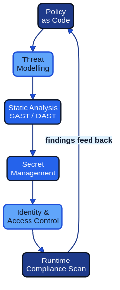
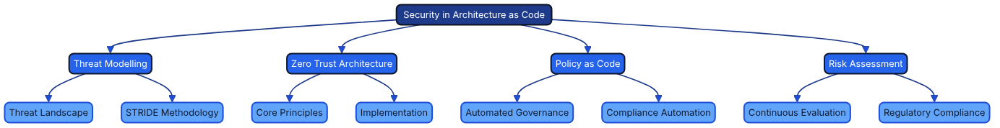
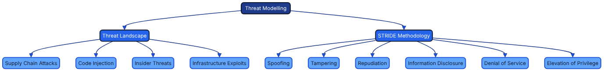
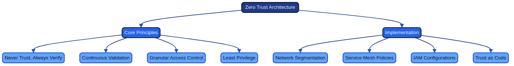
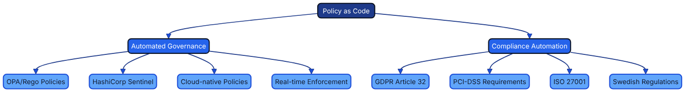
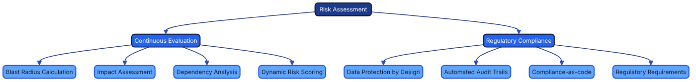

# Security Fundamentals for Architecture as Code {#security-fundamentals}

*Security is the backbone of a successful Architecture as Code implementation. This chapter explains how security principles are embedded from the first design sprint through automated policy enforcement, proactive threat management, and continuous compliance monitoring. Treating security as code enables organisations to deliver robust, scalable, and auditable protections without slowing delivery teams.*

## Dimensions of security architecture

*The overview mind map illustrates the four main dimensions of security in Architecture as Code: Threat Modeling, Zero Trust Architecture, Policy as Code, and Risk Assessment. Each dimension is explored in detail through dedicated mind maps.*

### Detailed security dimensions

#### Threat Modeling

*Threat Modeling encompasses understanding the threat landscape and applying methodologies like STRIDE to identify and mitigate security risks systematically.*

#### Zero Trust Architecture

*Zero Trust Architecture is built on core principles of continuous verification and implemented through network segmentation, service mesh policies, and granular access controls.*

#### Policy as Code

*Policy as Code enables automated governance and compliance automation through tools like OPA/Rego and HashiCorp Sentinel, ensuring regulatory requirements are met programmatically.*

#### Risk Assessment

*Risk Assessment involves continuous evaluation of blast radius and impact, combined with regulatory compliance measures to maintain data protection and audit trails.*

## Scope and goals of the chapter

The security challenges facing contemporary digital enterprises demand a fundamental reassessment of traditional defensive practices. As organisations adopt Architecture as Code to manage rapidly expanding and highly distributed environments, security strategies must evolve in parallel. This chapter offers a comprehensive guide to integrating security into code-based architectures without treating it as an afterthought.

Perimeter-based defences designed for static environments become ineffective in cloud-native and microservice-oriented platforms. Security can no longer be treated as a separate afterthought. Modern organisations must embrace security-as-code principles where critical decisions are codified, version-controlled, and automated alongside the rest of the architecture estate.

European organisations operate within a dense mesh of regulatory obligations. GDPR ([Source [43]](33_references.md#source-43)), enforced by national supervisory authorities such as IMY in Sweden and coordinated by the European Data Protection Board (EDPB) through the consistency mechanism, NIS2 Directive requirements for essential and important entities, sectoral regulations, and financial supervision requirements create a multidimensional compliance landscape. At the same time, ongoing digital transformation programmes demand faster innovation and shorter time-to-market. Architecture as Code addresses both pressures by automating compliance controls and embedding "secure by default" patterns into every delivery pipeline.

This chapter explores security from an integrated perspective that joins technical implementation, organisational processes, and regulatory requirements. Readers gain a deep understanding of threat modelling, risk assessment, policy automation, and incident response across code-driven environments. Advanced security architecture patterns for large-scale enterprises are covered in Chapter 9B.

## Theoretical foundation: security architecture in the digital era

### The paradigm shift from perimeter protection to Zero Trust

Traditional security philosophies relied on a clear boundary between the "inside" and "outside" of the enterprise. Network perimeters, firewalls, and VPN solutions created a "hard shell, soft centre" model where anything within the perimeter was implicitly trusted. That paradigm was viable when most resources were physically located in tightly controlled data centres and employees worked from fixed offices.

Modern operations dismantle those assumptions. Cloud services distribute workloads across multiple providers and regions. Remote working extends the security perimeter to every home network. API-driven architectures introduce enormous volumes of service-to-service communication that traditional controls struggle to monitor.

Zero Trust Architecture (ZTA) provides the necessary evolution in security thinking. The guiding principle of "never trust, always verify" requires explicit validation of every user, device, and network transaction regardless of location or prior authentication. Implementing ZTA demands granular identity management, continuous posture assessment, and policy-driven access controls.

In an Architecture as Code context, ZTA enables systematic implementation of trust policies. Network segmentation, service mesh rules, and identity and access management (IAM) configurations are defined declaratively and enforced consistently across all environments. The result is "trust as code", where security decisions become reproducible, testable, and auditable.

### Threat modelling for code-based architectures

Effective security architecture begins with a deep understanding of the threat landscape and relevant attack vectors. Threat modelling for Architecture as Code environments differs from traditional application modelling by including the infrastructure layer, CI/CD pipelines, and automation tooling as potential attack surfaces.

The STRIDE methodology provides a structured framework for identifying threats across architectural layers. In Architecture as Code ecosystems, STRIDE must be applied to infrastructure definitions, deployment pipelines, secrets management systems, and runtime environments alike.

| Threat Category | Description | Architecture as Code Concerns |
|-----------------|-------------|-------------------------------|
| Spoofing | Impersonating a user, system, or component | Compromised service accounts, stolen IAM credentials, forged infrastructure definitions |
| Tampering | Unauthorized modification of data or code | Malicious commits to infrastructure code, altered pipeline configurations, modified secrets |
| Repudiation | Denying actions without proper audit trail | Missing version control history, inadequate logging of infrastructure changes, untracked deployments |
| Information Disclosure | Exposing sensitive information | Secrets in code repositories, unencrypted data stores, overly permissive access policies |
| Denial of Service | Making systems unavailable | Resource exhaustion through misconfiguration, deletion of critical infrastructure, deployment failures |
| Elevation of Privilege | Gaining unauthorized access levels | Exploiting IAM misconfigurations, compromised deployment pipelines, privilege escalation in modules |

Supply chain attacks represent a particularly acute concern for code-based architectures. When infrastructure is defined through third-party modules, container images, and external APIs, dependency chains can be compromised. Incidents such as the 2020 SolarWinds breach demonstrate how adversaries can infiltrate development tooling to reach downstream targets.

Code injection attacks also take on new dimensions when infrastructure code is executed automatically. Malicious Terraform modules, corrupted Kubernetes manifests, or compromised Ansible playbooks can lead to privilege escalation, data exfiltration, or service outages at the architectural level. Insider threats must also be considered: developers with access to infrastructure code can alter security configurations, plant backdoors, or exfiltrate data through seemingly legitimate commits.

### Risk assessment and continuous compliance

Traditional risk assessments are performed periodically, often annually or following major releases. That approach is incompatible with continuous deployment and rapid infrastructure evolution. Continuous risk assessment embeds risk evaluation within the development life cycle through automated tooling and policy engines. Every infrastructure change is assessed for security impacts before deployment, with dynamic risk scores calculated from changes to the attack surface, data exposure, and compliance posture.

Quantitative risk analysis becomes more practical when infrastructure is defined as code. Blast radius calculations can be automated through dependency mapping. Potential impact assessments draw on data classification and service criticality encoded in infrastructure tags and metadata.

Compliance-as-code transforms audits from reactive exercises into proactive safeguards. Instead of verifying compliance after deployment, regulatory requirements are evaluated continuously within the delivery process. GDPR Article 25 ("Data protection by design and by default") can be implemented through automated policy checks that validate privacy controls from the first line of code.

## Policy as Code: automated security governance

### The evolution from manual to automated policy enforcement

Traditional governance relies on manual processes, document-heavy policies, and human-controlled safeguards. Security teams write policies in natural language, which are then interpreted and implemented by multiple delivery teams. This creates interpretation gaps, inconsistent implementations, and long delays between policy updates and technical enforcement.

Policy as Code replaces manual translations with machine-readable definitions that can be evaluated automatically against infrastructure configurations. This eliminates the implementation gap between policy intent and technical reality while enabling real-time enforcement.

Open Policy Agent (OPA) has emerged as a de facto standard for policy-as-code implementations. OPA's Rego language provides expressive syntax for complex policies that can be evaluated across diverse technology stacks. Rego policies integrate with CI/CD pipelines, admission controllers, API gateways, and runtime environments to ensure comprehensive coverage.

HashiCorp Sentinel offers an alternative focused on Infrastructure as Code workflows. Sentinel policies can be enforced at Terraform plan time to prevent non-compliant deployments. AWS Config Rules and Azure Policy deliver cloud-native policy engines with tight integration into their respective platforms.

### Integration with CI/CD for continuous policy enforcement

Successful policy-as-code programmes require deep integration with software delivery life cycles. Manual security reviews as gateways create bottlenecks that frustrate teams and delay releases. Automated policy evaluation enables a "security as an enabler" approach.

"Shift-left" security principles are particularly effective for policy enforcement. Validating policies during commit stages provides rapid feedback, enabling developers to address issues while context is fresh. Git hooks, pre-commit checks, and IDE extensions can deliver real-time feedback during development.

CI/CD integration extends policy checks across multiple stages. Static analysis of infrastructure code during build stages can detect obvious violations. Dynamic evaluations in staging environments catch configuration problems before production release. Production monitoring ensures policies remain effective throughout the operational life cycle.

Policy testing becomes a core element of the development process once policies are treated as code. Logic must be tested for positive and negative scenarios to validate correct behaviour under different conditions. Test-driven policy development yields robust implementations that behave predictably in edge cases. Gradual rollout strategies—including blue/green policy deployments, policy versioning, and structured rollback procedures—reduce disruption from policy changes.

### Control objectives that prove compliance repeatedly

Security teams often begin with high-level objectives—"enforce multi-factor authentication for privileged users" or "encrypt customer data at rest"—without a clear route to automated evidence. Architecture as Code breaks each objective into declarative assertions that can be executed inside pipelines and runtime monitors. Tests are written **once**, then reused wherever the same control objective appears, whether that is ISO 27001 Annex A, SOC 2 CC6, NIST 800-53 IA-2, or an internal policy. The [policy design example](10_policy_and_security.md#assure-once-comply-many-in-policy-design) shows how a single Rego module evaluates MFA consistently. Its outputs flow into [Evidence as Code](15a_evidence_as_code.md) to create machine-readable artefacts that auditors can consume without rebuilding bespoke test suites for every framework.

## Secrets management and data protection

### Comprehensive secrets lifecycle management

Modern distributed architectures multiply the number of secrets compared with monolithic systems. API keys, database credentials, encryption keys, certificates, and service tokens proliferate across microservices, containers, and cloud services. Embedding secrets in configuration files or environment variables creates significant vulnerabilities and operational complexity.

Comprehensive secrets management covers the entire lifecycle—from generation through distribution, rotation, and retirement. Automated key generation services such as HashiCorp Vault or cloud-native offerings like AWS Secrets Manager provide cryptographic standards with strong entropy. Manual secret creation should be the exception.

Distribution mechanisms must balance security with operational efficiency. Secrets should be delivered through secure channels such as encrypted configuration management systems, secrets management APIs, or runtime injection. Centralised secret storage should enforce encryption in transit and at rest. Hardware Security Modules (HSMs) or HSM-backed cloud services provide the highest level of protection for critical keys.

### Advanced encryption strategies for data protection

Protecting data requires addressing multiple states and access patterns: at rest, in transit, and in use. Key management is often the weakest link. Rotation policies must balance the benefits of frequent rotation with the operational effort of coordinating updates across distributed estates.

Application-level encryption provides granular safeguards that persist even if infrastructure is compromised. Field-level encryption for sensitive database columns, client-side encryption for sensitive inputs, and end-to-end encryption for service-to-service communication create layered defences.

Emerging techniques such as homomorphic encryption and secure multi-party computation enable computation on encrypted data. While adoption is still limited, Architecture as Code practices can prepare organisations for future integration through abstracted interfaces.

### Data classification and handling procedures

Effective protection begins with clear data classification. Automated discovery tools can assist through content analysis and pattern recognition, but human judgement remains essential for contextual accuracy. Hybrid approaches combining automation with human validation deliver the best results.

Handling procedures should be codified for each classification level, covering storage, transmission, processing, and disposal. Policy-as-code frameworks can enforce handling rules automatically, including retention policies and secure destruction processes. GDPR Article 25 requires controllers to build in measures that implement the Article 5 principles—data minimisation, purpose limitation and storage limitation—for example through automated deletion when retention periods expire.

### Protecting Infrastructure as Code state

Infrastructure state files capture live inventories, secrets, and the policy decisions enforced across environments. They must therefore be treated as sensitive artefacts rather than operational by-products. HashiCorp's documentation sets the principle-level baseline: keep state in a remote backend rather than on individual workstations, lock it during write operations so that concurrent runs cannot corrupt it, and recognise that sensitive values reach state and must be protected there ([Source [70]](33_references.md#source-70), [Source [71]](33_references.md#source-71), [Source [20]](33_references.md#source-20)). In practice this means encrypting state with customer-managed keys under the organisation's key management policy, restricting read access to pipeline identities, and treating every unexpected access to the backend as a security event.

The concrete controls for Amazon S3, Azure Storage and Google Cloud Storage backends, including S3-native locking, the governance checks that pipelines should run against every workspace, and the monitoring rules for state access, are set out as a reusable pattern in [Chapter 9B: Advanced Security Patterns and Implementation](09b_security_patterns.md). The [Governance and Security Controls as Code Backlog](11_governance_as_code.md#governance-and-security-controls-as-code-backlog) turns those expectations into sequenced issues for AWS, Azure, and Google Cloud, so that encryption verification, role separation, and policy-as-code gating become first-class acceptance criteria rather than aspirational guidance.

## Network security and micro-segmentation

### Modern network architecture for Zero Trust environments

Perimeter-led network security is unsuitable for cloud-native deployments where applications span multiple networks, data centres, and jurisdictions. Software-defined networking (SDN) moves network security from hardware appliances to code-driven control planes. Policies can be defined centrally and pushed automatically across hybrid environments, ensuring consistent enforcement regardless of underlying infrastructure.

Micro-segmentation provides granular, application-aware control compared with traditional VLANs or subnets. Traffic policies can be defined using application identity, user context, and data classification to reduce lateral movement opportunities.

Container networking introduces additional complexity. Containers within a pod share a network namespace, and pods communicate directly over a flat cluster network that bypasses traditional perimeter controls ([Source [13]](33_references.md#source-13)). Container Network Interface (CNI) plug-ins and NetworkPolicy objects restore segmentation by providing a consistent mechanism for implementing network policies for containerised workloads.

### Service mesh security architectures

Service mesh platforms solve inter-service security challenges in distributed applications. Mutual TLS (mTLS) enforced by the mesh ensures every service-to-service call is encrypted and authenticated. Identity certificates are provisioned and rotated automatically, eliminating manual management overhead.

Policy-driven traffic routing centralises advanced controls such as rate limiting, circuit breaking, and request filtering. Policies can be adjusted dynamically based on threat intelligence or service health. Service mesh observability—metrics, distributed tracing, and access logs—delivers deep visibility for rapid incident response and forensic investigations.

## Security maturity models for continuous improvement

Security maturity assessments provide structured frameworks for measuring current posture and prioritising investment. Maturity models such as ISACA's CMMI Cybermaturity Platform or the NIST CSF 2.0 tiers (Partial, Risk Informed, Repeatable, Adaptive) provide a graded ladder from initial reactive practices to optimised proactive operations ([Source [42]](33_references.md#source-42)). European organisations can benchmark against industry peers by repeating such assessments at regular intervals.

The NIST Cybersecurity Framework 2.0 (February 2024) is built around six functions—Govern, Identify, Protect, Detect, Respond, and Recover—where the new Govern function maps directly onto governance-as-code concerns ([Source [42]](33_references.md#source-42)). Embedding the framework into Architecture as Code enables systematic improvements with traceable outcomes.

This chapter has established the fundamental security principles and practices for Architecture as Code. The following chapter explores advanced security patterns, practical implementations, and future trends that build upon these foundations.

## Sources

1. **NIST (2024).** *The NIST Cybersecurity Framework (CSF) 2.0.* NIST CSWP 29, 26 February 2024. [https://doi.org/10.6028/NIST.CSWP.29](https://doi.org/10.6028/NIST.CSWP.29) [Source [42]](33_references.md#source-42)
2. **NIST (2020).** *Special Publication 800-207: Zero Trust Architecture.* National Institute of Standards and Technology, August 2020. [https://csrc.nist.gov/pubs/sp/800/207/final](https://csrc.nist.gov/pubs/sp/800/207/final)
3. **NIST (2020).** *Security and Privacy Controls for Information Systems and Organisations.* NIST Special Publication 800-53, Revision 5, 2020. [Source [11]](33_references.md#source-11)
4. **ISO/IEC (2022).** *ISO/IEC 27001:2022 Information Security Management Systems – Requirements.* International Organisation for Standardisation. [Source [14]](33_references.md#source-14)
5. **European Parliament and Council (2016).** *Regulation (EU) 2016/679 (General Data Protection Regulation).* Official Journal of the European Union, L 119, 4 May 2016. [Source [43]](33_references.md#source-43)
6. **EDPB (2020).** *Guidelines 4/2019 on Article 25 Data Protection by Design and by Default, Version 2.0.* European Data Protection Board, 20 October 2020. [https://www.edpb.europa.eu/our-work-tools/our-documents/guidelines/guidelines-42019-article-25-data-protection-design-and_en](https://www.edpb.europa.eu/our-work-tools/our-documents/guidelines/guidelines-42019-article-25-data-protection-design-and_en)
7. **European Parliament and Council (2022).** *Directive (EU) 2022/2555 on measures for a high common level of cybersecurity across the Union (NIS2 Directive).* Official Journal of the European Union, L 333, 27 December 2022. [https://eur-lex.europa.eu/eli/dir/2022/2555/oj](https://eur-lex.europa.eu/eli/dir/2022/2555/oj)
8. **ENISA (2025).** *NIS2 Technical Implementation Guidance, v1.0.* European Union Agency for Cybersecurity, June 2025. [https://www.enisa.europa.eu/publications/nis2-technical-implementation-guidance](https://www.enisa.europa.eu/publications/nis2-technical-implementation-guidance)
9. **European Parliament and Council (2022).** *Regulation (EU) 2022/2554 on digital operational resilience for the financial sector (DORA).* Official Journal of the European Union, L 333, 27 December 2022. [https://eur-lex.europa.eu/eli/reg/2022/2554/oj](https://eur-lex.europa.eu/eli/reg/2022/2554/oj)
10. **EBA (2019).** *Guidelines on ICT and security risk management (EBA/GL/2019/04).* European Banking Authority, 28 November 2019; amended by EBA/GL/2025/02. [https://www.eba.europa.eu/activities/single-rulebook/regulatory-activities/internal-governance/guidelines-ict-and-security-risk-management](https://www.eba.europa.eu/activities/single-rulebook/regulatory-activities/internal-governance/guidelines-ict-and-security-risk-management)
11. **ISACA.** *CMMI Cybermaturity Platform.* ISACA. [https://www.isaca.org/enterprise/cmmi-cybermaturity-platform](https://www.isaca.org/enterprise/cmmi-cybermaturity-platform)
12. **Open Policy Agent (2024).** *Policy as Code Overview.* CNCF OPA Project. [Source [10]](33_references.md#source-10)
13. **HashiCorp.** *Remote state.* Terraform documentation. [https://developer.hashicorp.com/terraform/language/state/remote](https://developer.hashicorp.com/terraform/language/state/remote) [Source [70]](33_references.md#source-70)
14. **HashiCorp.** *State locking.* Terraform documentation. [https://developer.hashicorp.com/terraform/language/state/locking](https://developer.hashicorp.com/terraform/language/state/locking) [Source [71]](33_references.md#source-71)
15. **HashiCorp.** *Manage sensitive data in your configuration.* Terraform documentation. [https://developer.hashicorp.com/terraform/language/manage-sensitive-data](https://developer.hashicorp.com/terraform/language/manage-sensitive-data) [Source [20]](33_references.md#source-20)
16. **Kubernetes Project (2024).** *Kubernetes Documentation: Concepts.* Kubernetes Project. [Source [13]](33_references.md#source-13)
17. **ENISA (2023).** *ENISA Threat Landscape 2023.* European Union Agency for Cybersecurity, October 2023. [https://www.enisa.europa.eu/publications/enisa-threat-landscape-2023](https://www.enisa.europa.eu/publications/enisa-threat-landscape-2023)
