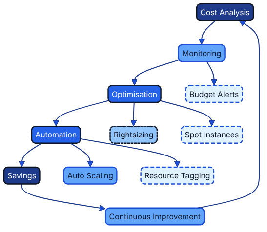
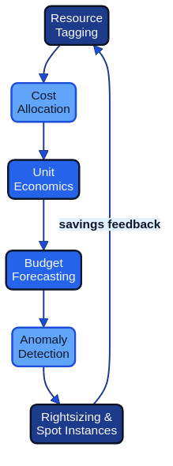
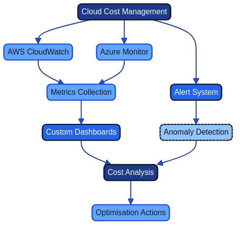

# Cost Optimisation and Resource Management {#cost-optimisation}

*Figure 15.1: The cost optimisation workflow demonstrates the systematic process from initial cost analysis through monitoring and optimisation to automation and savings. The process is continuous with feedback loops enabling constant improvement based on actual results. Key functions include budget alerts, resource rightsizing, use of spot instances, automatic scaling, and structured resource tagging.*

*Figure 15.2: This simplified view of the cost optimisation process illustrates how various components work together: from cost analysis via monitoring and optimisation to automation leading to concrete savings.*

## Overall Description

Cost optimisation forms a critical component in Architecture as Code implementations, particularly when organisations migrate to cloud-based solutions. Without proper cost management, cloud costs can rapidly escalate and undermine the economic benefits of Architecture as Code.

Modern cloud providers offer pay-as-you-use models which can be both advantageous and risky. Architecture as Code enables precise control over resource allocation and automated cost optimisation through policy-driven resource management and intelligent scaling.

EU organisations face unique challenges when applying cloud costs, including currency fluctuations between EUR and USD pricing, regulatory requirements affecting data storage under GDPR, and the need to balance cost efficiency with performance and security across multiple member states. Architecture as Code-based solutions offer tools to address these challenges systematically.

Successful cost optimisation requires a combination of technical tools, organisational processes, and cultural changes that promote cost-awareness amongst development and operations teams. This includes Architecture as Code implementation of FinOps practices that integrate financial accountability throughout the entire development lifecycle.

## FinOps and Cost Governance

*Figure 15.3: The FinOps cycle illustrates the continuous process of cost governance, from allocation and budgeting to policy management and optimisation. This iterative approach ensures that cost-awareness is integrated throughout the organisation's workflow.*

FinOps represents a growing discipline that combines financial management with cloud operations to maximise business value from cloud investments; the FinOps Foundation's framework structures the practice into the Inform, Optimize and Operate phases ([Source [93]](33_references.md#source-93)). Within the Architecture as Code context, this means integrating cost considerations directly into infrastructure definitions and deployment processes.

Governance frameworks for cost management must encompass automated policies for resource configuration, budget alerts, and regular cost analysis. HCP Terraform and Terraform Enterprise provide cost estimation as a run phase between plan and apply, which policy checks can evaluate before a change is applied, whilst AWS Cost Management and Microsoft Cost Management expose budgets, alerts, and cost data through APIs that Architecture as Code workflows can consume ([Source [94]](33_references.md#source-94)).

EU organisations must also handle compliance requirements that affect cost optimisation, such as GDPR-related data storage requirements that may restrict opportunities to use certain geographical regions with lower pricing. For example, organisations may need to maintain data within EU boundaries (eu-west-1 in Ireland, eu-central-1 in Frankfurt, eu-south-1 in Milan, or eu-west-3 in Paris) rather than using potentially lower-cost non-EU regions. Architecture as Code-based compliance policies can automate these constraints whilst optimising costs within permitted parameters.

Implementation of cost allocation tags and chargeback models through Architecture as Code enables transparent cost distribution between different teams, projects, and business units. This creates incentives for developers to make cost-optimal design decisions.

## Automatic Resource Scaling and Rightsizing

Automatic resource scaling forms the core of cost-effective Architecture as Code. By defining scaling rules based on actual usage patterns, organisations can avoid over-provisioning whilst ensuring adequate performance.

Kubernetes Horizontal Pod Autoscaler (HPA) and Vertical Pod Autoscaler (VPA) can be configured through Architecture as Code to automatically adjust resource allocation based on CPU, memory, and custom metrics. This is particularly valuable for EU organisations with varying working patterns across different time zones and member states, enabling predictable scaling that accounts for business hours in Dublin, Frankfurt, Paris, and other major centres.

Cloud providers offer rightsizing recommendations based on historical usage, but these must be integrated into Architecture as Code workflows to become actionable. Recommendations from AWS Compute Optimizer, Azure Advisor, and Google Cloud Recommender can be turned into reviewed Terraform changes, so that rightsizing passes through the same Architecture as Code review process as any other infrastructure change.

Machine learning-based predictive scaling models can be incorporated into Architecture as Code definitions to anticipate resource load and pre-emptively scale infrastructure. This is particularly effective for companies with seasonal variations or predictable business cycles across different EU markets.

## Cost Monitoring and Alerting

*Figure 15.4: This diagram shows the cost monitoring architecture with integration of CloudWatch/Azure Monitor, customised dashboards, and alert systems. Data flows from metrics collection through reporting and anomaly detection to cost analysis, ultimately resulting in concrete optimisation actions.*

Comprehensive cost monitoring requires integration of monitoring tools directly into Architecture as Code configurations. Granular cost data comes from AWS Cost Explorer and the Cost and Usage Report, Microsoft Cost Management, and Cloud Billing export to BigQuery, whilst CloudWatch billing alarms, Azure Monitor, and Google Cloud budgets can be configured as code to trigger alerts when threshold values are exceeded.

Real-time cost tracking enables proactive cost management instead of reactive measures after budgets are already exceeded. Architecture as Code-based monitoring solutions can automatically implement cost controls such as resource termination or approval workflows for cost-critical operations.

EU organisations' reporting requirements can be automated through Architecture as Code-defined dashboards and reports that are generated regularly and distributed to relevant stakeholders. Integration with enterprise ERP systems supports financial planning and budgeting, with support for multi-currency reporting (EUR, GBP, and other EU currencies) alongside cloud provider billing in USD.

Anomaly detection for cloud costs can be implemented through machine learning algorithms trained on historical usage patterns. These can be integrated into Architecture as Code workflows to automatically flag and potentially remediate abnormal cost spikes across different EU regions.

## Multi-Cloud Cost Optimisation

Multi-cloud strategies complicate cost optimisation but also offer opportunities for cost arbitrage between different providers. Architecture as Code tools like Terraform enable consistent cost management across different cloud providers through unified configuration and monitoring.

Cross-cloud cost comparison requires normalisation of pricing models and service offerings between providers. Open source tools such as Cloud Custodian (policy enforcement, a CNCF incubating project) and OpenCost (Kubernetes cost allocation, the CNCF incubating project from which the commercial IBM Kubecost product originates) can be integrated into Architecture as Code pipelines to automate cost attribution and reporting ([Source [92]](33_references.md#source-92)); the cross-provider comparison itself remains an analytical exercise that these tools inform rather than perform.

Data transfer costs between cloud providers often form an invisible cost source that can be optimised through strategic architecture design. Architecture as Code-based network topology can minimise inter-cloud traffic whilst maximising intra-cloud efficiency. For EU organisations, this is particularly relevant when balancing data sovereignty requirements with cost optimisation—for example, maintaining workloads in eu-west-1 (Ireland) and eu-central-1 (Frankfurt) to ensure GDPR compliance whilst minimising inter-region data transfer costs.

Cloud sovereignty frameworks, such as the Gaia-X data space model referenced in Chapter 25, provide a shared vocabulary for describing residency, portability, and supply-chain expectations. Encoding those guardrails alongside FinOps policies ensures that cost models account for the approved jurisdictions, egress thresholds, and encryption standards required for European compliance. Architecture as Code modules should therefore expose parameters for sovereign zones, permitted providers, and classification-driven controls so that cost optimisation never undermines the regulatory guardrails discussed in the broader cloud sovereignty narrative.

Hybrid cloud strategies can optimise costs by retaining certain workloads on-premises whilst cloud-native workloads are moved to the cloud. Architecture as Code enables coordinated management of both environments with unified cost tracking and optimisation. This is especially relevant for EU financial services organisations that must balance regulatory requirements with cost efficiency.

### Market Outlook and Economic Rationale

Independent market research indicates that Infrastructure as Code investment is accelerating as organisations industrialise automation. MarketsandMarkets (2022) [Source [47]](33_references.md#source-47) forecast in August 2022 that the global Infrastructure as Code market would expand from USD 0.8 billion in 2022 to USD 2.3 billion by 2027, a compound annual growth rate of 24.0 per cent; the forecast is now four years old and should be read as an indication of direction rather than a current estimate. The shift from exploratory pilots to enterprise-scale programmes reflects the need for verifiable guardrails and reusable automation patterns in regulated industries.

Gartner's press release of 13 November 2023 forecast worldwide end-user spending on public cloud services at USD 678.8 billion for 2024, a year-on-year increase of 20.4 per cent ([Source [45]](33_references.md#source-45)); Gartner's November 2024 update then put 2024 spending at USD 595.7 billion and forecast USD 723.4 billion for 2025 ([Source [46]](33_references.md#source-46)). Finance leaders therefore expect Architecture as Code and FinOps disciplines to provide measurable returns on escalating cloud commitments by codifying reservation strategies, budget thresholds, and sustainability metrics alongside delivery pipelines.

In the author's experience, an increasing share of DevOps tooling budgets is directed towards platform engineering, automation, and configuration management. Treating Architecture as Code artefacts as governed, reusable assets ensures those expenditures translate into durable capabilities, providing the economic rationale executives require when prioritising IaC-led transformation.

## Practical Examples

### Cost-Aware Terraform Configuration

To implement cost-aware infrastructure with Terraform, a structured approach is needed that combines budget management, cost allocation tagging, and intelligent resource selection strategies. A complete implementation includes:

| Component | Purpose | Implementation Details |
|-----------|---------|------------------------|
| Cost allocation tags | Metadata for cost tracking | Tags for all resources with cost centre, project, environment, and owner information |
| AWS Budget alerts | Proactive cost monitoring | Automatic notifications at 80% and 100% of budget thresholds |
| Spot instance configuration | Cost-effective compute | Mixed instance types for optimal cost efficiency |
| Auto Scaling groups | Balanced capacity management | Mixed instances policy balancing on-demand and spot instances |

*For complete code examples with all configuration details, see [15_CODE_1: Cost-aware Terraform infrastructure configuration](30_appendix_code_examples.md#15_code_1) in Appendix A.*

### Kubernetes Cost Optimisation

Kubernetes environments require careful resource governance to avoid over-provisioning and control costs. Key components include:

| Kubernetes Component | Purpose | Cost Optimisation Impact |
|---------------------|---------|--------------------------|
| ResourceQuotas | Set hard limits on CPU, memory, and pod count per namespace | Prevents resource over-allocation, enforces budget constraints |
| LimitRanges | Define default and maximum values for container resources | Ensures consistent resource sizing, prevents runaway consumption |
| Vertical Pod Autoscaler (VPA) | Automatic adjustment of resource requests based on actual usage | Right-sizes containers, eliminates over-provisioning |
| Horizontal Pod Autoscaler (HPA) | Scale number of replicas based on CPU and memory utilisation | Matches capacity to demand, reduces idle resources |

*For complete Kubernetes manifests, see [15_CODE_2: Kubernetes cost optimisation manifests](30_appendix_code_examples.md#15_code_2) in Appendix A.*

### Cost Monitoring Automation

Automated cost monitoring and optimisation requires integration with cloud provider APIs to:

- Analyse cost trends over time with grouping per service and project
- Identify rightsizing opportunities for EC2 instances based on actual utilisation
- Detect unused resources such as unattached EBS volumes, unused elastic IPs, and idle load balancers
- Generate comprehensive cost optimisation plans with potential savings

*For complete Python implementation of AWS cost optimiser, see [15_CODE_3: AWS cost monitoring and optimisation automation](30_appendix_code_examples.md#15_code_3) in Appendix A.*

## Commitment-Based Pricing: Reserved Instances and Savings Plans

Commitment-based pricing is often the single largest source of cloud cost reduction available to organisations. By committing to a defined usage level over a one- or three-year term, organisations receive substantial discounts compared to on-demand rates. Architecture as Code workflows can codify reservation strategies so that purchasing decisions are traceable, reviewed, and aligned with capacity forecasts.

| Provider | Offering | Maximum Savings vs On-Demand (provider figures) |
|----------|----------|------------------------------|
| AWS | Reserved Instances (Standard and Convertible) | Up to 72% (Standard), up to 66% (Convertible) |
| AWS | Compute Savings Plans (flexible across instance families, sizes, and regions) | Up to 66% |
| AWS | EC2 Instance Savings Plans | Up to 72% |
| Azure | Reserved VM Instances (one- or three-year commitments) | Up to 72% |
| Google Cloud | Committed Use Discounts (resource-based and spend-based) | Up to 55% resource-based (up to 70% for memory-optimised machine series); 28–46% for flexible spend-based CUDs |

The percentages are the maximum discounts published by the providers as of October 2026: AWS Compute and EC2 Instance Savings Plans ([Source [95]](33_references.md#source-95)), [Amazon EC2 Reserved Instances pricing](https://aws.amazon.com/ec2/pricing/reserved-instances/), [Azure Reservations pricing](https://azure.microsoft.com/en-us/pricing/reservations/), and Google Cloud committed use discounts ([Source [98]](33_references.md#source-98)). Realised savings depend on term length, payment option, and how well the commitment matches actual usage.

Key considerations when adopting commitment-based pricing:

- **Baseline before committing:** Analyse at least 30–90 days of usage data to identify stable, predictable workloads suitable for reservation. Architecture as Code cost monitoring pipelines can automate this analysis.
- **Prefer flexible instruments:** AWS Compute Savings Plans and Google Cloud spend-based Committed Use Discounts apply across a broader range of services than instance-level reservations, reducing the risk of stranded commitments as architectures evolve.
- **Align with FinOps governance:** Reservation purchases should be governed through the same approval workflows as infrastructure changes, with cost centre tagging that attributes savings to the appropriate teams.
- **Combine with rightsizing:** Committing to the wrong instance size locks in waste. Rightsizing recommendations (see the Automatic Resource Scaling and Rightsizing section above) should be acted upon before making multi-year commitments.
- **Review and renew:** Commitment portfolios require periodic review—at least annually—to retire expired reservations, adjust coverage as workloads change, and capture newly available discount programmes.

## Summary

Cost becomes manageable once it is treated like any other property of the architecture: declared in code, estimated in the pipeline and reviewed alongside the change that causes it. Cost optimisation within Architecture as Code requires a systematic approach that combines technical tools, automated processes, and organisational awareness. Successful implementation results in significant cost savings whilst performance and security are maintained.

Key success factors include proactive monitoring, automated rightsizing, intelligent use of spot instances and reserved capacity, and continuous optimisation based on actual usage patterns. FinOps practices ensure cost considerations are naturally integrated into the development process.

In the author's experience, EU organisations that implement these strategies typically reduce their cloud operating costs by 20–40 per cent, although actual savings vary with workload profile and baseline optimisation maturity, whilst ensuring regulatory compliance (particularly GDPR data residency requirements) and performance requirements. Multi-region strategies across EU zones (such as eu-west-1 in Ireland and eu-central-1 in Frankfurt) enable both compliance and cost optimisation through intelligent workload placement.

## Sources

1. **Amazon Web Services (2024).** *AWS Well-Architected Framework* (Cost Optimization pillar). AWS whitepaper, 6 November 2024, [https://docs.aws.amazon.com/wellarchitected/latest/framework/cost-optimization.html](https://docs.aws.amazon.com/wellarchitected/latest/framework/cost-optimization.html). [Source [91]](33_references.md#source-91)
2. **FinOps Foundation.** *FinOps Framework.* The Linux Foundation, [https://www.finops.org/framework/](https://www.finops.org/framework/) (accessed 2026-10-30). [Source [93]](33_references.md#source-93)
3. **OpenCost.** *OpenCost Documentation: Overview.* CNCF OpenCost project, [https://www.opencost.io/docs/](https://www.opencost.io/docs/) (accessed 2026-10-30). [Source [92]](33_references.md#source-92)
4. **MarketsandMarkets (2022).** *Infrastructure as Code Market – Global Forecast to 2027.* Report TC 8140, August 2022 (press release 3 May 2023), [https://www.marketsandmarkets.com/Market-Reports/infrastructure-as-code-market-115458264.html](https://www.marketsandmarkets.com/Market-Reports/infrastructure-as-code-market-115458264.html). [Source [47]](33_references.md#source-47)
5. **Gartner (2023).** *Gartner Forecasts Worldwide Public Cloud End-User Spending to Reach $679 Billion in 2024.* Press release, 13 November 2023, [https://www.gartner.com/en/newsroom/press-releases/2023-11-13-gartner-forecasts-worldwide-public-cloud-end-user-spending-to-reach-679-billion-in-20240](https://www.gartner.com/en/newsroom/press-releases/2023-11-13-gartner-forecasts-worldwide-public-cloud-end-user-spending-to-reach-679-billion-in-20240). [Source [45]](33_references.md#source-45)
6. **Gartner (2024).** *Gartner Forecasts Worldwide Public Cloud End-User Spending to Total $723 Billion in 2025.* Press release, 19 November 2024, [https://www.gartner.com/en/newsroom/press-releases/2024-11-19-gartner-forecasts-worldwide-public-cloud-end-user-spending-to-total-723-billion-dollars-in-2025](https://www.gartner.com/en/newsroom/press-releases/2024-11-19-gartner-forecasts-worldwide-public-cloud-end-user-spending-to-total-723-billion-dollars-in-2025). [Source [46]](33_references.md#source-46)
7. **Microsoft Learn (2025).** *Optimize your cloud investment with Cost Management.* Microsoft Learn, 9 July 2025, [https://learn.microsoft.com/en-us/azure/cost-management-billing/costs/cost-mgt-best-practices](https://learn.microsoft.com/en-us/azure/cost-management-billing/costs/cost-mgt-best-practices). [Source [94]](33_references.md#source-94)
8. **Amazon Web Services.** *Compute Savings Plans.* AWS pricing documentation, [https://aws.amazon.com/savingsplans/compute-pricing/](https://aws.amazon.com/savingsplans/compute-pricing/) (accessed 2026-10-30). [Source [95]](33_references.md#source-95)
9. **Google Cloud.** *Committed use discounts (CUDs) for Compute Engine.* Google Cloud documentation, [https://docs.cloud.google.com/compute/docs/instances/committed-use-discounts-overview](https://docs.cloud.google.com/compute/docs/instances/committed-use-discounts-overview) (accessed 2026-10-30). [Source [98]](33_references.md#source-98)
