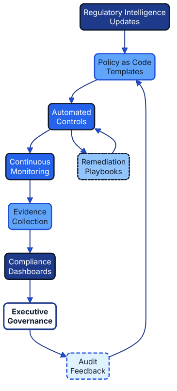

# Evidence as Code and Continuous Assurance {#evidence-as-code}



## Learning Objectives

By the end of this chapter, you will be able to:

- Describe the characteristics of machine-generated compliance evidence and explain why deterministic capture is preferable to manual attestation.
- Design a CI/CD pipeline that produces, packages, and publishes evidence bundles with framework metadata attached.
- Generate a Software Bill of Materials (SBOM) and integrate it into an evidence collection workflow.
- Implement cryptographic attestation to create tamper-evident supply chain artefacts using SLSA principles.
- Map evidence artefacts to multiple regulatory frameworks using the **assure once, comply many** principle to eliminate duplicate audit effort.

Evidence is the currency that allows Architecture as Code to demonstrate trustworthiness at scale. Treating evidence as code means the artefacts that prove compliance are generated automatically, stored alongside the controls they verify, and versioned so that their provenance is unquestionable. Combined with the **assure once, comply many** principle, evidence captured for a single control objective can be replayed across multiple regulatory frameworks without repeating manual audits.

## Machine-collected, versioned artefacts

Evidence as Code systems collect machine-readable outputs—policy evaluation reports, Terraform plans, cloud configuration snapshots, build logs—directly from delivery pipelines. Artefacts are stored in immutable storage with cryptographic signing and metadata that references the originating control, environment, and timestamp. By keeping these artefacts in the same repositories as policies and blueprints, teams create a living catalogue that auditors can browse without requesting ad hoc exports.

Key characteristics include:

- **Deterministic capture:** Evidence is generated from automated checks, not manual screenshots.
- **Traceability:** Artefacts link back to commit SHAs, pull requests, and ticket references.
- **Reusability:** Metadata enumerates which frameworks and obligations each artefact supports, avoiding duplicate test runs.
- **Version control:** Evidence follows the same branching strategy as code so historic attestations remain discoverable.

## Pipeline example: exporting MFA evidence

The following pseudo-CI configuration shows how one control—the enforcement of multi-factor authentication for human identities—produces artefacts that downstream reporting systems can reuse.

```yaml
jobs:
  verify-mfa:
    runs-on: ubuntu-latest
    steps:
      - uses: actions/checkout@v4
      - name: Prepare evidence directory
        run: |
          mkdir -p artefacts
          echo "SNAPSHOT_DATE=$(date +%Y%m)" >> "$GITHUB_ENV"
      - name: Unit-test the MFA policy
        run: opa test policies/identity
      - name: Snapshot cloud identities
        run: |
          python scripts/export_mfa_snapshot.py \
            --accounts production \
            --output "artefacts/mfa-snapshot-${SNAPSHOT_DATE}.json"
      - name: Evaluate MFA policy against the snapshot
        run: |
          opa eval \
            --data policies/identity \
            --input "artefacts/mfa-snapshot-${SNAPSHOT_DATE}.json" \
            --format json \
            "data.enterprise.identity.mfa.violation" \
            > artefacts/policy-report.json
      - name: Publish evidence package
        run: |
          jq --arg filepath "artefacts/mfa-snapshot-${SNAPSHOT_DATE}.json" \
            --arg control "SEC-ID-001" \
            --argjson mappings '{"iso_27001":["A.5.15","A.5.17","A.8.5"],"soc_2":["CC6.1","CC6.6"],"nist_800_53":["IA-2(1)","IA-2(2)","AC-2"],"gdpr":["Article 32"],"internal":["IAM-01"]}' \
            -n '{
              "control_id": $control,
              "framework_mappings": $mappings,
              "artefacts": [
                "artefacts/policy-report.json",
                $filepath
              ]
            }' > artefacts/manifest.json
      - name: Upload evidence bundle
        uses: actions/upload-artifact@v4
        with:
          name: sec-id-001
          path: artefacts/
```

The `opa test` step gates the job on the policy's own unit tests, whereas the `opa eval` step produces the control evidence by evaluating the MFA policy from [Policy and Security as Code in Detail](10_policy_and_security.md#assure-once-comply-many-in-policy-design) against the identity snapshot; the `internal` mapping carries the organisation's own catalogue identifier (`IAM-01`) for control `SEC-ID-001`. The job produces a manifest and two evidence files. Governance and compliance teams consume the manifest to update the [Control Mapping Matrix](appendix_d_control_mapping_matrix_template.md) and to demonstrate coverage across ISO 27001, SOC 2, NIST 800-53, GDPR, and internal catalogues. Because the artefacts live alongside the policy, they can be retrieved for regulator-specific attestations without re-running the control unless configuration changes occur.

## Software Bill of Materials as Evidence

A Software Bill of Materials (SBOM) is a machine-readable inventory of every component, library, and dependency in a software artefact [Source [89]](33_references.md#source-89). Regulatory frameworks such as US Executive Order 14028 on Improving the Nation's Cybersecurity and the EU Cyber Resilience Act (Regulation (EU) 2024/2847) increasingly require software producers to generate SBOMs and to provide them to purchasers or, on request, to authorities. Generating SBOMs as part of the build pipeline transforms them from a one-off compliance exercise into continuous evidence.

### Generating SBOMs with Syft

[Syft](https://github.com/anchore/syft) produces SBOMs in CycloneDX and SPDX formats directly from container images or directory trees:

```bash
# Generate a CycloneDX SBOM from a container image
syft my-service:latest -o cyclonedx-json > artefacts/sbom-cyclonedx.json

# Generate an SPDX SBOM from a Python project directory
syft dir:. -o spdx-json > artefacts/sbom-spdx.json
```

### Integrating SBOM generation into CI

```yaml
- name: Generate SBOM
  uses: anchore/sbom-action@v0
  with:
    image: ${{ env.IMAGE_NAME }}:${{ env.IMAGE_TAG }}
    artifact-name: sbom-${{ env.IMAGE_TAG }}.spdx.json
    output-file: artefacts/sbom.spdx.json
    format: spdx-json

- name: Scan SBOM for vulnerabilities
  uses: anchore/scan-action@v7
  with:
    sbom: artefacts/sbom.spdx.json
    output-format: json
    output-file: artefacts/vulnerability-report.json
    fail-build: true
    severity-cutoff: critical

- name: Attach SBOM to evidence manifest
  run: |
    python3 - <<'EOF'
    import json, datetime, hashlib, pathlib

    sbom_path = pathlib.Path("artefacts/sbom.spdx.json")
    sbom_hash = hashlib.sha256(sbom_path.read_bytes()).hexdigest()

    manifest = {
        "control_id": "SEC-SUPPLY-001",
        "generated_at": datetime.datetime.now(datetime.timezone.utc).isoformat(),
        "framework_mappings": {
            "nist_ssdf": ["PS.3.1", "PS.3.2"],
            "iso_27001": ["A.5.21", "A.8.8"],
            "soc_2": ["CC7.1"],
            "executive_order_14028": ["Section 4(e)"]
        },
        "artefacts": [
            {"path": "artefacts/sbom.spdx.json", "sha256": sbom_hash}
        ]
    }
    pathlib.Path("artefacts/sbom-manifest.json").write_text(json.dumps(manifest, indent=2))
    print("SBOM evidence manifest written.")
    EOF
```

### Vulnerability tracking as continuous evidence

The vulnerability report produced by the scan step becomes an evidence artefact in its own right. Storing it alongside the SBOM creates a time-stamped record that demonstrates the organisation actively monitors its software supply chain—a requirement under frameworks such as NIST SP 800-53 SI-2 (Flaw Remediation) [Source [11]](33_references.md#source-11). The manifest's SSDF mapping points to practice PS.3.2, which expects provenance data such as SBOMs to be collected, safeguarded, and shared for every release, and to PS.3.1 for the secure archiving of release files [Source [86]](33_references.md#source-86); the ISO/IEC 27001:2022 controls are 5.21 (information security in the ICT supply chain) and 8.8 (management of technical vulnerabilities) [Source [14]](33_references.md#source-14).

## Attestation Frameworks and Tamper-Evident Artefacts

Evidence value erodes if consumers cannot verify it was produced by trusted systems using approved processes. Cryptographic attestation addresses this by binding artefacts to verifiable claims about how they were created.

### SLSA provenance

Supply-chain Levels for Software Artifacts (SLSA) defines a framework for describing and verifying the provenance of software [Source [87]](33_references.md#source-87). A SLSA provenance attestation records the build platform, the external parameters that defined the build, the resolved dependencies, and the output digests, signed by the build platform's identity. The current specification is v1.2; the predicate below follows the v1 provenance format, whose `predicateType` is always written without a minor version:

```json
{
  "_type": "https://in-toto.io/Statement/v1",
  "subject": [
    {
      "name": "my-service",
      "digest": {
        "sha256": "abc123..."
      }
    }
  ],
  "predicateType": "https://slsa.dev/provenance/v1",
  "predicate": {
    "buildDefinition": {
      "buildType": "https://actions.github.io/buildtypes/workflow/v1",
      "externalParameters": {
        "workflow": {
          "ref": "refs/heads/main",
          "repository": "https://github.com/myorg/my-service",
          "path": ".github/workflows/release.yml"
        }
      },
      "internalParameters": {
        "github": {
          "event_name": "push",
          "repository_id": "123456789",
          "repository_owner_id": "987654321",
          "runner_environment": "github-hosted"
        }
      },
      "resolvedDependencies": [
        {
          "uri": "git+https://github.com/myorg/my-service@refs/heads/main",
          "digest": {
            "gitCommit": "def456..."
          }
        }
      ]
    },
    "runDetails": {
      "builder": {
        "id": "https://github.com/myorg/my-service/.github/workflows/release.yml@refs/heads/main"
      },
      "metadata": {
        "invocationId": "https://github.com/myorg/my-service/actions/runs/1234567890/attempts/1",
        "startedOn": "2026-01-15T09:00:00Z",
        "finishedOn": "2026-01-15T09:12:00Z"
      }
    }
  }
}
```

Storing signed provenance alongside every release artefact allows downstream consumers—internal teams, regulators, or customers—to independently verify the artefact's build chain without trusting the producing organisation's word alone.

### Cosign for container image signing

[Cosign](https://docs.sigstore.dev/cosign/signing/overview/) signs container images and stores signatures in the same registry as the image, making verification straightforward [Source [88]](33_references.md#source-88):

```bash
# Sign the image with a key stored in Google Cloud KMS
cosign sign \
  --key gcpkms://projects/my-project/locations/europe-west2/keyRings/ci/cryptoKeys/signing \
  my-registry/my-service:v1.2.3

# Verify the signature before deploying
cosign verify \
  --key gcpkms://projects/my-project/locations/europe-west2/keyRings/ci/cryptoKeys/signing \
  my-registry/my-service:v1.2.3
```

Admission controllers in Kubernetes clusters (for example, using Sigstore's Policy Controller) can enforce that only signed and verified images are permitted to run, creating a continuous attestation chain from source code to production workload.

## Evidence Lifecycle Management

Evidence has a useful life that varies by regulatory context. Some frameworks require evidence retention for one year; others mandate seven years or more. A systematic approach to evidence lifecycle management prevents both premature deletion and uncontrolled accumulation:

| Lifecycle Stage | Activity | Tooling |
|-----------------|----------|---------|
| Capture | Automated pipeline step produces artefact | OPA, Syft, Cosign, cloud CLI tools |
| Packaging | Evidence manifest links artefacts to control IDs and framework mappings | Python/jq scripts, custom GitHub Actions |
| Storage | Artefacts stored in immutable object storage with versioning | AWS S3, Azure Blob, Google Cloud Storage |
| Indexing | Manifest registered in evidence catalogue for audit queries | SQLite, PostgreSQL, or a dedicated GRC platform |
| Retrieval | Auditors or automated tools query catalogue by control ID or framework | REST API, direct database query |
| Expiry | Artefacts past retention period are archived or deleted per policy | Lifecycle rules on object storage |
| Access Control | Tamper-evident evidence stores require IAM/RBAC governance to restrict who can write, read, and delete evidence artefacts; least-privilege policies should be codified and reviewed regularly | AWS IAM, Azure RBAC, Google Cloud IAM; OPA-enforced bucket policies |

## Integrating with governance and blueprints

[Governance as Code](11_governance_as_code.md) defines the approval guardrails that keep evidence pipelines authoritative. [Policy and Security as Code](10_policy_and_security.md) contributes reusable policy modules enriched with metadata for framework mapping. [Security Fundamentals](09_security_fundamentals.md) explains how control objectives become executable assertions, while [Compliance and Regulatory Adherence](12_compliance.md) uses the Control Mapping Matrix to translate artefacts into regulator-friendly language. Platform teams embed these patterns into their blueprints, as described in [FINOS Project Blueprint](32_finos_project_blueprint.md), so that every environment exports evidence in a predictable manner. Together these chapters show how evidence captured once can sustain multiple obligations throughout the delivery lifecycle.

## Summary

Evidence as Code transforms compliance from a periodic, manual exercise into a continuous, automated discipline. Machine-generated artefacts captured at each pipeline run provide auditors with verifiable proof that controls were active at specific points in time, eliminating the scramble to reconstruct evidence at audit season. SBOMs extend this visibility into the software supply chain, while cryptographic attestation—through SLSA provenance and Cosign signatures—ensures that evidence consumers can independently verify the integrity of what they receive.

The evidence lifecycle framework connects capture, packaging, storage, and retrieval into a coherent system that serves multiple frameworks simultaneously. When combined with the **assure once, comply many** principle, a single investment in evidence infrastructure yields dividends across ISO 27001, SOC 2, NIST 800-53, GDPR, and any future obligation the organisation encounters. This is not merely an efficiency gain; it is a structural shift in how organisations relate to compliance—from reactive to proactive, from opaque to transparent, from manual to automated.

## Sources

1. **Souppaya, M., Scarfone, K. & Dodson, D. (2022).** *Secure Software Development Framework (SSDF) Version 1.1: Recommendations for Mitigating the Risk of Software Vulnerabilities.* NIST Special Publication 800-218, February 2022. [https://doi.org/10.6028/NIST.SP.800-218](https://doi.org/10.6028/NIST.SP.800-218) [Source [86]](33_references.md#source-86)
2. **OpenSSF SLSA project.** *SLSA Provenance.* Supply-chain Levels for Software Artifacts specification v1.0 (current specification: v1.2). [https://slsa.dev/spec/v1.0/provenance](https://slsa.dev/spec/v1.0/provenance) [Source [87]](33_references.md#source-87)
3. **Sigstore.** *Cosign: Signing overview.* Sigstore documentation. [https://docs.sigstore.dev/cosign/signing/overview/](https://docs.sigstore.dev/cosign/signing/overview/) [Source [88]](33_references.md#source-88)
4. **NTIA (2021).** *The Minimum Elements For a Software Bill of Materials (SBOM).* US Department of Commerce, National Telecommunications and Information Administration, 12 July 2021. [https://www.ntia.gov/report/2021/minimum-elements-software-bill-materials-sbom](https://www.ntia.gov/report/2021/minimum-elements-software-bill-materials-sbom) [Source [89]](33_references.md#source-89)
5. **Open Policy Agent.** *Open Policy Agent documentation.* Cloud Native Computing Foundation. [https://www.openpolicyagent.org/docs](https://www.openpolicyagent.org/docs) [Source [10]](33_references.md#source-10)
6. **NIST (2020).** *Security and Privacy Controls for Information Systems and Organizations.* NIST Special Publication 800-53, Revision 5, September 2020 (updated 10 December 2020). [Source [11]](33_references.md#source-11)
7. **ISO/IEC (2022).** *ISO/IEC 27001:2022 Information Security Management Systems – Requirements.* International Organization for Standardization. [Source [14]](33_references.md#source-14)
8. **European Parliament and Council (2016).** *Regulation (EU) 2016/679 (General Data Protection Regulation).* Official Journal of the European Union, L 119, 4 May 2016. [https://eur-lex.europa.eu/eli/reg/2016/679/oj](https://eur-lex.europa.eu/eli/reg/2016/679/oj) [Source [43]](33_references.md#source-43)
