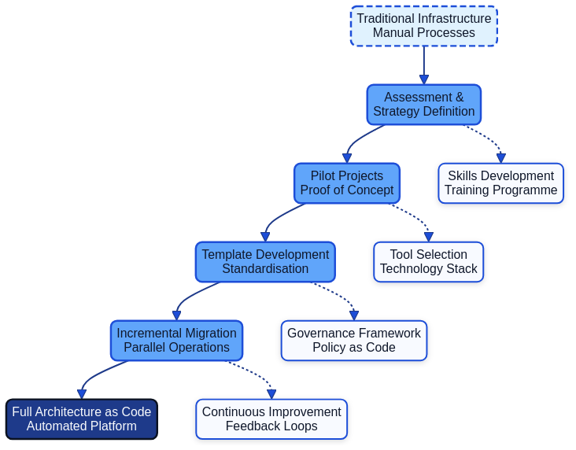
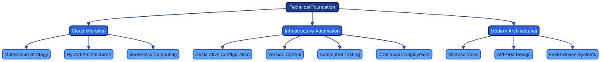
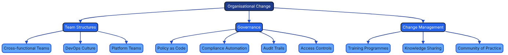
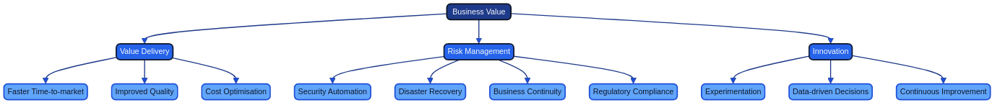

# Digitalisation through Code-based Infrastructure {#digitalisation}



*Figure 21.1 highlights how Architecture as Code supports modern digital transformation initiatives by enabling rapid, scalable, and cost-effective evolution of IT environments from manual processes to automated, declarative infrastructure management.*

## Learning Objectives

By the end of this chapter, you will be able to:

- Explain how Architecture as Code enables digital transformation across technical, organisational, cultural, and competency dimensions.
- Identify the key regulatory drivers—including GDPR, the NIS2 Directive, and EDPB guidelines—that shape cloud-first strategies for organisations operating in the EU.
- Evaluate cloud provider offerings against data sovereignty and compliance requirements, distinguishing between EU-native providers and globally headquartered hyperscalers operating within EU sovereign boundaries.
- Design a GDPR-compliant Infrastructure as Code template that incorporates encryption, audit logging, and parameterised EU region selection.
- Apply cloud-first architecture principles to construct self-service developer portals and automated compliance pipelines.
- Critically assess the limitations of keyword-based CI compliance checks and identify appropriate policy-as-code tooling alternatives.

## Digital Transformation Landscape



*Figure 21.2 shows the technical dimensions of digital transformation, including cloud migration, infrastructure automation, and modern architecture patterns.*



*Figure 21.3 illustrates the organisational changes required, including team structures, governance, and change management practices.*



*Figure 21.4 demonstrates how Architecture as Code delivers business value through improved delivery, risk management, and continuous innovation.*

## Overview

Digital transformation represents more than the introduction of new technology—it embodies a fundamental shift in how organisations deliver value to customers and stakeholders. Architecture as Code plays a central role in this transformation by enabling agile, cloud-based solutions that adapt to evolving business needs whilst maintaining robust governance, security, and compliance frameworks.

### Digital Transformation Challenges and Opportunities

Public and private sector organisations worldwide face significant digital transformation challenges where legacy IT structures often form bottlenecks for innovation and efficiency. The scale of investment is enormous: IDC forecasts that worldwide spending on digital transformation will reach almost USD 4 trillion in 2027, growing at a compound annual rate of 16.2 per cent over 2022–2027 ([Source [110]](33_references.md#source-110)). In our experience much of that spending underdelivers when infrastructure governance is weak and technical debt is allowed to accumulate—the two problems this chapter sets out to address.

Architecture as Code-based solutions offer opportunities to break these limitations through automation, standardisation, and scalability that specifically address common transformation challenges:

**Regulatory Compliance**: Organisations must navigate complex EU-wide legislation including the GDPR (Regulation (EU) 2016/679, [Source [43]](33_references.md#source-43)) under guidance from the European Data Protection Board (EDPB), the NIS2 Directive (Directive (EU) 2022/2555) on cybersecurity obligations for essential and important entities ([Source [114]](33_references.md#source-114)), sector-specific regulations, and data sovereignty requirements across member states. Architecture as Code enables automated compliance checking and audit trails that ensure continuous regulatory adherence across distributed European environments whilst meeting the expectations of European regulatory authorities.

**Cost Efficiency**: With rising operational costs and competitive pressure, Architecture as Code automation becomes critical for maintaining competitiveness. Infrastructure as Code removes much of the manual effort of provisioning and configuration, enabling organisations to reallocate skilled personnel to higher-value activities whilst reducing operational expenses.

**Skills Challenges**: The IT industry experiences persistent shortages of specialist talent, making it critical to standardise and automate infrastructure management. Architecture as Code enables smaller, specialised teams to manage complex environments through reusable templates, proven patterns, and community best practices.

**Security and Data Governance**: Organisations across the EU prioritise security and data control in an increasingly regulated landscape, guided by EDPB guidelines, enforced by national supervisory authorities under the GDPR, and bound by the NIS2 Directive's obligations for essential and important entities. Architecture as Code enables consistent security configurations, encryption-at-rest as standard, and policy-as-code enforcement aligned with EDPB guidelines that builds trust with customers, regulators, and stakeholders throughout the European Union.

Code-based infrastructure enables DevOps methodologies that unite development and operations, resulting in faster delivery cycles and higher quality. This proves particularly vital for organisations competing in global markets whilst maintaining compliance with diverse EU member state regulations and harmonised European security requirements.

### Digital Transformation Dimensions

The digital transformation process through Architecture as Code encompasses multiple dimensions that organisations must address holistically:

**Technical Transformation**: Migration from on-premise data centres to hybrid and multi-cloud architectures that respect EU data residency requirements. This includes implementing microservices, containerisation, and API-first architectures that enable rapid innovation whilst maintaining operational resilience across member states.

**Organisational Change**: Introduction of cross-functional teams aligned with agile principles, balancing autonomous delivery with necessary oversight. Organisations must adapt hierarchical structures whilst preserving essential governance, risk management, and compliance frameworks.

**Cultural Evolution**: Shift towards data-driven decision-making and experimental learning whilst maintaining appropriate risk awareness and long-term strategic thinking. This requires careful change management that respects organisational values around stability, transparency, and stakeholder engagement.

**Competence Development**: Systematic upskilling of existing personnel in Architecture as Code technologies, combining theoretical knowledge with practical application through hands-on training, mentorship programmes, and community collaboration.

Successful Architecture as Code implementation requires balance between these aspects, with particular focus on organisational needs for transparency, stakeholder consensus, and sustainable transformation that delivers lasting value.

### Digital Transformation Success Stories

Several global organisations have executed exemplary digital transformations that demonstrate Architecture as Code's potential:

**Spotify**: Grew from a European start-up into a global platform with hundreds of millions of monthly active users, and did so while changing its foundations: Spotify announced in February 2016 that it would move from its own and leased data centres to Google Cloud, had routed all traffic to Google Cloud by May 2017, and retired the last of its four data centres in 2018 ([Source [116]](33_references.md#source-116)). Their "Spotify Model" for agile organisation has inspired companies worldwide, demonstrating how technical excellence and organisational design reinforce one another.

**Stripe**: Transformed the payments industry through API-first architecture built on Infrastructure as Code, enabling expansion to 46 countries with consistent security and compliance. Their approach to regulated fintech innovation has become a model for other technology companies entering highly regulated sectors.

**Netflix**: Executed a comprehensive digital transformation from DVD-by-post distributor to global streaming platform, completing a seven-year migration from its own data centres to AWS in January 2016 ([Source [115]](33_references.md#source-115)). Automated, code-defined infrastructure enabled the development of personalised recommendation systems and content delivery that serve hundreds of millions of subscribers across diverse geographic regions.

**Capital One**: Pioneered cloud adoption in the financial services sector through a cloud-first strategy, closing its own data centres in 2020 after an eight-year migration to AWS. AWS's case study reports 70 per cent faster disaster-recovery times in tests and development environments built in minutes rather than three months ([Source [117]](33_references.md#source-117)).

These migration stories demonstrate that organisations can achieve world-leading digital transformation through strategic use of Architecture as Code combined with organisational strengths in innovation, design thinking, and sustainable business practices—and that none of them started cloud-native: each rebuilt its foundations while operating at scale.

## Cloud-First Strategies for Digital Transformation

Organisations across the European Union have developed strong positions within cloud technology, driven by ambitious digitalisation goals across public and private sectors. Cloud-first strategies mean that organisations primarily choose cloud-based solutions for new initiatives, requiring comprehensive Architecture as Code competence adapted to EU regulatory frameworks, security requirements, and operational standards.

### Enterprise Digital Strategy and Architecture as Code

Modern digital strategies across the EU emphasise cloud technology's role in achieving goals for integrated, efficient service delivery. The hyperscalers' own adoption frameworks—AWS's Cloud Adoption Framework ([Source [111]](33_references.md#source-111)) and Microsoft's Cloud Adoption Framework ([Source [112]](33_references.md#source-112))—structure such programmes from strategy and governance through platform, security and operations, and HashiCorp's recommended practices describe the matching evolution of provisioning from manual changes to collaborative Infrastructure as Code ([Source [113]](33_references.md#source-113)). Leading organisations specify that teams should:

- Prioritise cloud-first solutions complying with EU data sovereignty regulations
- Implement automated architecture enabling shared IT services across organisational units
- Develop common platforms for user services based on open-source technologies
- Ensure cybersecurity and resilience through Infrastructure as Code-based controls aligned with EDPB guidance and NIS2 directive requirements

This creates demand for Architecture as Code solutions that handle sensitive data according to GDPR and sector-specific EU regulations whilst enabling innovation and efficiency. Practically, this means:


```hcl
# Enterprise Architecture as Code Template for GDPR-Compliant Cloud
terraform {
  required_version = ">= 1.11" # S3-native state locking (use_lockfile) is GA from 1.11

  required_providers {
    aws = {
      source  = "hashicorp/aws"
      version = "~> 5.0"
    }
  }

  # Encrypted, locked state storage for compliance. A backend block cannot
  # reference variables, so the EU region and KMS key are supplied at init
  # time through partial configuration:
  #   terraform init -backend-config=backend.eu-central-1.hcl
  backend "s3" {
    bucket       = "enterprise-terraform-state"
    key          = "production/terraform.tfstate"
    encrypt      = true
    use_lockfile = true # S3-native locking; DynamoDB-based locking is deprecated
  }
}

# Enterprise resource tags for governance
locals {
  enterprise_tags = {
    Organisation       = var.organisation_name
    Environment        = var.environment
    CostCentre         = var.cost_centre
    DataClassification = var.data_classification
    ComplianceLevel    = var.compliance_level
    EUCompliance       = "GDPR"
    # Avoid timestamp() in tags: it changes on every run and produces a
    # perpetual diff. Record creation dates in the state or audit log instead.
  }
}

# VPC for enterprise workloads with security zones
resource "aws_vpc" "enterprise_vpc" {
  cidr_block           = var.vpc_cidr
  enable_dns_hostnames = true
  enable_dns_support   = true
  
  tags = merge(local.enterprise_tags, {
    Name = "${var.organisation_name}-vpc"
    Purpose = "Enterprise VPC for digital services"
  })
}

# Security zones following best practices
resource "aws_subnet" "public_zone" {
  count = length(var.availability_zones)
  
  vpc_id            = aws_vpc.enterprise_vpc.id
  cidr_block        = cidrsubnet(var.vpc_cidr, 8, count.index)
  availability_zone = var.availability_zones[count.index]
  
  map_public_ip_on_launch = false  # No automatic public IP for security
  
  tags = merge(local.enterprise_tags, {
    Name         = "${var.organisation_name}-public-${count.index + 1}"
    SecurityZone = "Public"
    Tier         = "DMZ"
  })
}

resource "aws_subnet" "application_zone" {
  count = length(var.availability_zones)
  
  vpc_id            = aws_vpc.enterprise_vpc.id
  cidr_block        = cidrsubnet(var.vpc_cidr, 8, count.index + 10)
  availability_zone = var.availability_zones[count.index]
  
  tags = merge(local.enterprise_tags, {
    Name         = "${var.organisation_name}-app-${count.index + 1}"
    SecurityZone = "Application"
    Tier         = "Internal"
  })
}

resource "aws_subnet" "data_zone" {
  count = length(var.availability_zones)
  
  vpc_id            = aws_vpc.enterprise_vpc.id
  cidr_block        = cidrsubnet(var.vpc_cidr, 8, count.index + 20)
  availability_zone = var.availability_zones[count.index]
  
  tags = merge(local.enterprise_tags, {
    Name         = "${var.organisation_name}-data-${count.index + 1}"
    SecurityZone = "Data"
    Tier         = "Restricted"
  })
}
```

The region and key identifiers live in a small partial-configuration file that is passed to `terraform init`, which keeps the template itself free of environment-specific values:

```hcl
# backend.eu-central-1.hcl – partial backend configuration for terraform init
region     = "eu-central-1"
kms_key_id = "arn:aws:kms:eu-central-1:123456789012:key/REPLACE-WITH-KEY-ID"
```

Two details matter for compliance reviews. First, the backend uses S3-native locking (`use_lockfile = true`) instead of a DynamoDB table, which is why the template requires Terraform 1.11 or later ([Source [17]](33_references.md#source-17)); the state controls behind this choice are set out in [Chapter 9B: Advanced Security Patterns and Implementation](09b_security_patterns.md). Second, bucket versioning—which HashiCorp recommends so that state can be recovered after accidental deletion—is a property of the S3 bucket resource rather than an argument of the backend block, and it is not an audit log; audit evidence comes from CloudTrail data events or S3 server access logging on the state bucket.

### Enterprise Cloud-First Success Stories

Global enterprises such as Spotify, Netflix, and Capital One have demonstrated leadership by rebuilding their technical platforms on cloud infrastructure while continuing to operate at scale—Netflix completed its AWS migration in 2016, Spotify retired its last data centres in 2018, and Capital One closed its own data centres in 2020. Their success demonstrates how Architecture as Code enables rapid scaling and global expansion whilst minimising technical debt and maintaining organisational values around sustainability and innovation.

**Spotify's Developer Platform for Global Scaling:**
Spotify created its internal developer portal, Backstage, in 2016, open-sourced it in March 2020, donated it to the CNCF Sandbox in September 2020, and saw it accepted as a CNCF incubating project in March 2022 ([Source [118]](33_references.md#source-118)). Backstage provides a framework for building internal developer portals—a software catalogue, templates and documentation in one place—rather than an Infrastructure as Code platform per se, and it addresses developer experience and service ownership at scale rather than user growth as such. The pattern it represents includes:

- Microservices with dedicated infrastructure definitions per service, registered in a software catalogue
- Software templates that bake compliance defaults into new services from the start
- Cost-aware scaling that supports sustainability objectives
- Developer self-service that reduces onboarding and provisioning time

**Capital One's Regulated Financial Infrastructure as Code:**
As a licensed financial institution, Capital One must follow strict regulatory requirements whilst innovating rapidly. Their Infrastructure as Code strategy includes:

- Automated audit trails for all infrastructure changes
- Real-time compliance monitoring according to PCI DSS and financial regulatory guidelines
- Immutable infrastructure enabling point-in-time recovery
- Multi-region deployment for business continuity according to industry standards

### Cloud Provider Ecosystem

Cloud-first implementation requires careful planning of hybrid and multi-cloud strategies. Organisations must navigate between different cloud providers whilst ensuring data sovereignty and regulatory compliance across EU member states.

Sovereignty guardrails described in [Chapter 15B on cost optimisation](15_cost_optimization.md) and [Chapter 25 on future trends](25_future_trends.md) demand explicit provider selection policies. Platform teams should codify which services qualify as "EU-trusted"—covering both EU-headquartered providers and EU-specific offerings from global hyperscalers—and enforce those decisions through policy-as-code. This keeps residency, lawful access controls, and the Gaia-X or EU Cloud Code of Conduct commitments consistent across delivery teams.

Policy catalogues should therefore differentiate between providers that are inherently sovereign and those that become acceptable only when their EU-only controls are in force. EU-headquartered platforms form the default choice for workloads bound by strict sovereignty clauses. Global hyperscalers remain viable when their EU sovereign programmes (such as AWS European Sovereign Cloud, Azure EU Data Boundary, or Google Cloud Sovereign Controls) deliver European legal entities, locally staffed operations, and independent encryption key custody. Standard global services that fall outside those safeguards should fail policy-as-code checks so that teams avoid contradictory guidance.

**AWS European Sovereign Cloud and EU Regions:**
The AWS European Sovereign Cloud became generally available on 14 January 2026 as a physically and logically separate partition (`aws-eusc`) whose first Region, `eusc-de-east-1`, is located in Brandenburg, Germany, operates independently of the existing AWS Regions and is open to customers regardless of where they are based ([Source [119]](33_references.md#source-119)). When AWS is approved through the European Sovereign Cloud or standard EU Regions, Architecture as Code guardrails must confirm the following conditions:

- Physical data sovereignty within EU regional boundaries—and, for the sovereign cloud, use of the `aws-eusc` partition rather than a standard EU Region
- Low-latency connectivity across EU availability zones and Local Zones
- Comprehensive compliance certifications and attestations, including ISO/IEC 27001, SOC 2 reports, and PCI DSS
- Dedicated support with European expertise and GDPR compliance guidance

**Microsoft Azure EU Data Boundary and Sovereign Cloud:**
Microsoft reported its EU Data Boundary complete in February 2025 and, in June 2025, grouped its European offerings under the Microsoft Sovereign Cloud banner (sovereign public cloud, sovereign private cloud and national partner clouds). These commitments provide a compliant route when policies verify that workloads remain inside the boundary and that the relevant sovereign controls are enabled:

- Azure regions across multiple EU member states for data residency
- Integration with enterprise identity providers
- Compliance with EU governance standards, EDPB guidelines, and Azure confidential computing controls
- Partnership ecosystem with European system integrators

**Google Cloud Sovereign Controls:**
Google Cloud's partner-operated sovereign controls—run with T-Systems in Germany and with S3NS, the Thales-operated French entity—qualify when technical and organisational safeguards are enforced:

- EU-based data processing for GDPR compliance across all member states
- Advanced AI/ML capabilities for research and innovation
- Integration with open-source ecosystems

**European Sovereign Cloud Providers:**
European-native providers deliver offerings that satisfy strict localisation requirements and public sector procurement rules:

- **OVHcloud** provides Gaia-X aligned services with full EU legal jurisdiction and SecNumCloud qualification for French public sector workloads.
- **Scaleway** delivers sovereign cloud regions, Bare Metal, and Kubernetes platforms operated entirely within the EU with transparent supply-chain disclosure.
- **Open Telekom Cloud**, operated by T-Systems on OpenStack with data centres in Germany and the Netherlands, provides German and broader EU data residency for regulated industries; it is distinct from the Google-based sovereign controls that T-Systems operates, described above.

Architecture as Code pipelines should allow these providers to be selected as first-class modules. Policy-as-code guardrails can then ensure that workloads default to an EU-native provider when contractual or regulatory obligations prohibit the use of global hyperscalers, or verify that hyperscaler services are constrained to their EU sovereign offerings.

## Digital Transformation in Enterprises

Organisations worldwide are undergoing comprehensive digital transformation processes. Architecture as Code forms the technical foundation enabling this transformation by creating flexible, scalable, and cost-effective IT environments.

Traditional industrial companies such as Siemens and ABB have extended their business models with industrial IoT, AI and data analytics platforms built on modern cloud infrastructure. Code-based infrastructure underpins such platforms, but it is an enabler rather than the cause of new revenue streams.

Public sector organisations have also embraced Architecture as Code as a tool to modernise citizen services. Digital platforms for e-services, open data, and smart city initiatives build on code-based infrastructure that adapts to different organisational needs and resources.

Challenges within digital transformation include skills shortages, cultural resistance, and complex legacy systems. Architecture as Code helps address these challenges by standardising processes, enabling iterative development, and reducing technical complexity.

## Practical Examples

Practical examples in this chapter illustrate how a European enterprise can orchestrate cross-provider infrastructure and governance without sacrificing compliance.
The full multi-cloud landing zone blueprint now lives in Appendix A as listing [21_CODE_1](30_appendix_code_examples.md#21_code_1), ensuring the chapter focuses on strategy whilst readers still have access to the execution-ready Terraform module.

### Automated Compliance Pipeline
```yaml
# .github/workflows/compliance-check.yml
name: EU Compliance and Security Check

on:
  pull_request:
    paths: ['infrastructure/**']

jobs:
  gdpr-compliance:
    runs-on: ubuntu-latest
    permissions:
      contents: read
    steps:
      - uses: actions/checkout@v7

      - uses: hashicorp/setup-terraform@v4

      - name: Initialise Terraform without a backend
        run: terraform -chdir=infrastructure init -backend=false -input=false

      - name: GDPR Data Mapping (EDPB Guidelines)
        run: |
          set -euo pipefail
          # WARNING: Grepping for 'encryption' keywords is not a meaningful GDPR compliance
          # check — it may pass even when encryption is explicitly disabled. For real compliance
          # gates, use dedicated policy tools such as Trivy (trivy config), Checkov or OPA/Conftest;
          # tfsec has been merged into Trivy and Terrascan is archived. This example is illustrative only.
          terraform -chdir=infrastructure plan -input=false | grep -E "(encrypt|encryption)"

      - name: NIS2 Directive Compliance
        if: contains(github.event.pull_request.title, 'critical-infrastructure')
        run: |
          # Validate NIS2 requirements for essential and important entities
          ./scripts/nis2-compliance-check.sh

      - name: PCI DSS Checks
        if: contains(github.event.pull_request.title, 'payment')
        run: |
          # Validate PCI DSS requirements for payment infrastructure
          ./scripts/pci-compliance-check.sh

      - name: EU Security Requirements Validation
        run: |
          # EU-wide security requirements for critical infrastructure
          ./scripts/eu-security-validation.sh
```

### Self-Service Developer Portal
```python
# developer_portal/infrastructure_provisioning.py
from flask import Flask, request, jsonify
# Note: the TerraformRunner interface below is illustrative. There is no official
# HashiCorp Python SDK; drive Terraform from Python with subprocess.run(['terraform', ...]),
# a wrapper such as python-terraform, or the HCP Terraform API. (An unrelated third-party
# 'terraform-runner' package exists on PyPI but does not provide this interface.)
from terraform_runner import TerraformRunner
import kubernetes.client as k8s

app = Flask(__name__)

@app.route('/provision/environment', methods=['POST'])
def provision_development_environment():
    """
    Automatic provisioning of development environment
    for enterprise development teams with EU compliance
    """
    team_name = request.json.get('team_name')
    project_type = request.json.get('project_type')
    compliance_level = request.json.get('compliance_level', 'standard')
    eu_region = request.json.get('eu_region', 'eu-central-1')  # Parameterized EU region
    
    # Validate organisational structure
    if not validate_team_structure(team_name):
        return jsonify({'error': 'Invalid team structure'}), 400
    
    # Configure environment based on EU regulatory requirements
    config = {
        'team': team_name,
        'region': eu_region,  # User-selected EU region for data residency
        'encryption': True,
        'audit_logging': True,
        'gdpr_compliance': True,
        'edpb_guidelines': True,
        'nis2_compliance': compliance_level in ['critical', 'essential'],
        'retention_policy': '7_years' if compliance_level == 'financial' else '3_years'
    }
    
    # Run Terraform for infrastructure provisioning
    tf_runner = TerraformRunner()
    result = tf_runner.apply_configuration(
        template='enterprise_development_environment',
        variables=config
    )
    
    return jsonify({
        'environment_id': result['environment_id'],
        'endpoints': result['endpoints'],
        'compliance_report': result['compliance_status'],
        'eu_region': eu_region,
        'edpb_compliant': True
    })

def validate_team_structure(team_name):
    """Validate team name according to organisational standard"""
    # Implementation for validation of team structure
    return True
```


## Summary

Digital transformation through code-based infrastructure represents a fundamental shift in how organisations deliver IT services and create business value. Architecture as Code enables the flexibility, scalability, and security required for successful digital transformation whilst maintaining robust governance frameworks.

Success factors include strategic planning of cloud-first initiatives, comprehensive automation of delivery processes, and continuous competence development within organisations. Organisations that embrace these principles position themselves strongly for sustainable growth and competitive advantage.

Key lessons from digital transformation initiatives demonstrate that technical transformation must combine with organisational and cultural change to achieve lasting results. Architecture as Code forms the technical foundation, but success requires a holistic perspective on transformation that engages people, processes, and technology in concert.

## From Implementation to Integration

The organisational transformation explored in this part—from [changing team structures](17_organisational_change.md) and [competency development](18_team_structure.md) through [Management as Code](19_management_as_code.md), the [interplay between soft as code disciplines](23_soft_as_code_interplay.md) and [AI agent teams](20_ai_agent_team.md) to digitalisation—provides the human and process foundations for Architecture as Code success. However, these disciplines achieve their full potential when they work together rather than in isolation.

Part F turns from organisation to experience. [Chapter 22 on Documentation as Code versus Architecture as Code](22_documentation_vs_architecture.md) clarifies the difference between communicating an architecture and enforcing it, and [Chapter 24 on Best Practices and Lessons Learned](24_best_practices.md) synthesises lessons learned from diverse contexts into practical, actionable guidance.

## Sources

1. **IDC (2024).** *Worldwide Spending on Digital Transformation is Forecast to Reach Almost $4 Trillion by 2027, According to New IDC Spending Guide.* Press release, 30 May 2024. [https://www.idc.com/resource-center/press-releases/worldwide-spending-on-digital-transformation-is-forecast-to-reach-almost-4-trillion-by-2027-according-to-new-idc-spending-guide/](https://www.idc.com/resource-center/press-releases/worldwide-spending-on-digital-transformation-is-forecast-to-reach-almost-4-trillion-by-2027-according-to-new-idc-spending-guide/) [Source [110]](33_references.md#source-110)
2. **European Parliament and Council (2016).** *Regulation (EU) 2016/679 (General Data Protection Regulation).* Official Journal of the European Union, L 119, 4 May 2016. [https://eur-lex.europa.eu/eli/reg/2016/679/oj](https://eur-lex.europa.eu/eli/reg/2016/679/oj) [Source [43]](33_references.md#source-43)
3. **European Parliament and Council (2022).** *Directive (EU) 2022/2555 on measures for a high common level of cybersecurity across the Union (NIS 2 Directive).* Official Journal of the European Union, L 333, 27 December 2022. [https://eur-lex.europa.eu/eli/dir/2022/2555/oj](https://eur-lex.europa.eu/eli/dir/2022/2555/oj) [Source [114]](33_references.md#source-114)
4. **Amazon Web Services (2021).** *An Overview of the AWS Cloud Adoption Framework.* AWS Whitepaper, 22 November 2021. [https://docs.aws.amazon.com/whitepapers/latest/overview-aws-cloud-adoption-framework/welcome.html](https://docs.aws.amazon.com/whitepapers/latest/overview-aws-cloud-adoption-framework/welcome.html) [Source [111]](33_references.md#source-111)
5. **Microsoft.** *Cloud Adoption Framework for Microsoft.* Microsoft Learn. [https://learn.microsoft.com/en-us/azure/cloud-adoption-framework/](https://learn.microsoft.com/en-us/azure/cloud-adoption-framework/) [Source [112]](33_references.md#source-112)
6. **HashiCorp.** *Terraform recommended practices.* HCP Terraform documentation. [https://developer.hashicorp.com/terraform/cloud-docs/recommended-practices](https://developer.hashicorp.com/terraform/cloud-docs/recommended-practices) [Source [113]](33_references.md#source-113)
7. **HashiCorp.** *Backend Type: s3.* Terraform documentation. [https://developer.hashicorp.com/terraform/language/backend/s3](https://developer.hashicorp.com/terraform/language/backend/s3) [Source [17]](33_references.md#source-17)
8. **Izrailevsky, Y. (2016).** *Completing the Netflix Cloud Migration.* Netflix, February 2016. [https://about.netflix.com/news/completing-the-netflix-cloud-migration](https://about.netflix.com/news/completing-the-netflix-cloud-migration) [Source [115]](33_references.md#source-115)
9. **Gustavsson, N. (2019).** *Views From The Cloud: A History of Spotify's Journey to the Cloud, Part 1.* Spotify Engineering, 9 December 2019. [https://engineering.atspotify.com/2019/12/views-from-the-cloud-a-history-of-spotifys-journey-to-the-cloud-part-1-2](https://engineering.atspotify.com/2019/12/views-from-the-cloud-a-history-of-spotifys-journey-to-the-cloud-part-1-2) [Source [116]](33_references.md#source-116)
10. **Amazon Web Services (2020).** *Migrating from Data Centers to AWS: Capital One Case Study.* AWS Customer Success Stories. [https://aws.amazon.com/solutions/case-studies/capital-one-all-in-on-aws/](https://aws.amazon.com/solutions/case-studies/capital-one-all-in-on-aws/) [Source [117]](33_references.md#source-117)
11. **Cloud Native Computing Foundation (2022).** *Backstage project joins the CNCF Incubator.* CNCF blog, 15 March 2022. [https://www.cncf.io/blog/2022/03/15/backstage-project-joins-the-cncf-incubator/](https://www.cncf.io/blog/2022/03/15/backstage-project-joins-the-cncf-incubator/) [Source [118]](33_references.md#source-118)
12. **Stormacq, S. (2026).** *Opening the AWS European Sovereign Cloud.* AWS News Blog, 14 January 2026. [https://aws.amazon.com/blogs/aws/opening-the-aws-european-sovereign-cloud/](https://aws.amazon.com/blogs/aws/opening-the-aws-european-sovereign-cloud/) [Source [119]](33_references.md#source-119)
