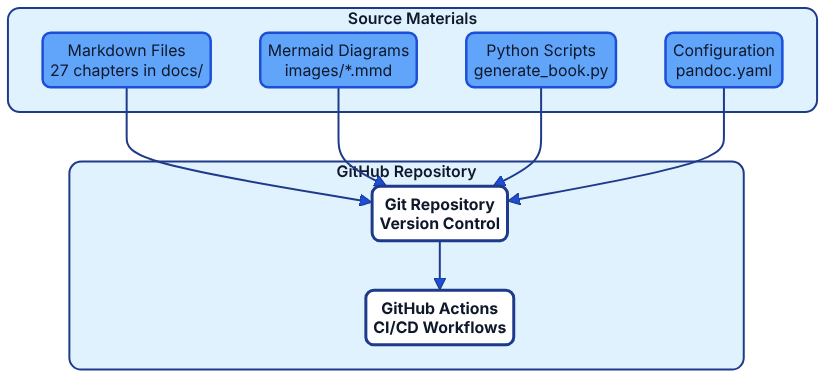
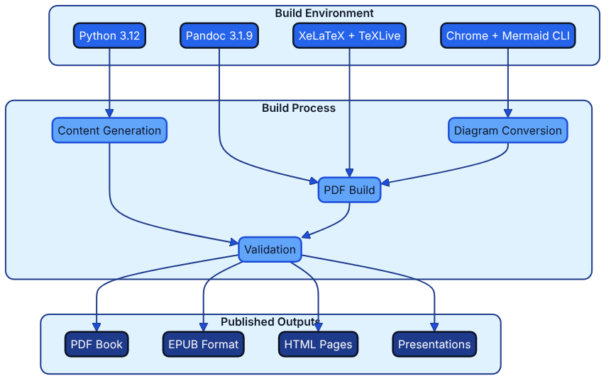

# Appendix B: Technical Architecture for Book Production {.unnumbered} {#appendix-b-technical-architecture}

This appendix describes the technical infrastructure and workflow that produce, build, and publish "Architecture as Code". The system is a practical demonstration of Architecture as Code principles, showing how code defines and automates the entire book production process.



*The first diagram shows how source materials (Markdown files, diagrams, scripts, and configuration) flow through version control and GitHub Actions.*



*The second diagram illustrates the build environment, processing steps, and the various output formats produced from the source materials.*

### File Organisation and Naming Conventions

Book content is organised in 38 chapter and appendix files within the `docs/` directory—31 chapters and 7 appendices, as listed in the canonical index `docs/book_index.json`—together with eight part introductions (`part_*.md`), the front cover (`00_front_cover.md`), and three supplements (the maturity model, the maturity radar tool, and the control mapping matrix template). Numbered files follow the pattern `NN_name.md`; letter suffixes (`09b`, `15a`, `26a`) mark chapters inserted after the original numbering, and the reading order is defined by the index rather than by the file names:

```text
docs/
├── 00_front_cover.md                        # Cover artwork and release metadata
├── part_a_foundations.md … part_h_appendices.md           # Eight part introductions
├── 01_introduction.md … 04_adr.md                         # Part A: Foundations (1, 26A, 2, 3, 4)
├── 05_automation_devops_cicd.md … 08_microservices.md     # Part B: Architecture Platform (5–8)
├── 09_security_fundamentals.md … 15a_evidence_as_code.md  # Part C: Security, Governance & Assurance (9, 9B, 9C, 10, 11, 12, 15A)
├── 13_testing_strategies.md … 16_migration.md             # Part D: Delivery & Operations (13, 14, 15B, 16)
├── 17_organisational_change.md … 21_digitalisation.md     # Part E: Organisation & Leadership (17, 18, 19, 23, 20, 21)
├── 22_documentation_vs_architecture.md, 24_best_practices.md  # Part F: Experience & Best Practices (22, 24)
├── 25_future_trends.md … 27_conclusion.md                 # Part G: Future & Wrap-up (25, 26B, 27)
├── 28_glossary.md                           # Glossary
├── 29_about_the_author.md                   # About the Author
├── 30_appendix_code_examples.md             # Appendix A: Code Examples
├── 31_appendix_b_technical_architecture.md  # Appendix B: this appendix
├── 32_finos_project_blueprint.md            # Appendix C: FINOS Project Blueprint
├── 33_references.md                         # References and Sources
├── appendix_templates_and_tools.md          # Appendix D: Templates and Tools
├── architecture_as_code_maturity_model.md   # Supplement: maturity model
├── maturity_model_radar.html                # Supplement: maturity radar tool
└── appendix_d_control_mapping_matrix_template.md  # Supplement: control mapping matrix
```

### Markdown Structure and Semantics

Each chapter follows a consistent structure that optimises both readability and automated processing. The template below demonstrates how headings, diagrams, lists, and code samples are arranged.

```markdown
# Chapter Title (H1 – creates a new page in the PDF)

Introductory text with a short description of the chapter’s contents.


*Caption that explains the diagram content.*

## Main section (H2)
### Sub-section (H3)
#### Detail section (H4)

- Bullet points for structured content
- Code examples in fenced code blocks
- References and sources
```

This layout ensures that readers can skim the content quickly, while the build pipeline can reliably transform every chapter into the desired publication formats.

### Automated Content Generation

Automated chapter generation is deliberately disabled to protect the British English manuscript in `docs/`; the legacy `generate_iac_book_content()` routine remains in `generate_book.py` but is no longer called. Today the script is a build and selection tool:

- **Canonical ordering**: Reads the chapter list from `docs/book_index.json` through `scripts/navigation.py`.
- **Chapter selection**: `--all` (the default), `--sample`, or `--chapters` chooses which files are included.
- **EPUB build**: `python3 generate_book.py --format epub --output dist/book.epub --all` assembles the selected chapters into an EPUB, optionally validated with `--validate` (EPUBCheck).
- **Manual content notice**: Run without arguments, the script prints a notice explaining that content generation stays disabled.
- **Version control**: Every change to the manuscript is tracked through Git.

## Alignment with the FINOS Architecture as Code project

> **Note:** FINOS Architecture as Code and its CALM specification form a separate open-source project hosted by the Fintech Open Source Foundation. This book covers the broader Architecture as Code methodology and is not affiliated with or dependent on that project or its tooling.

The FINOS Architecture as Code project describes its aim as devising and managing software architecture through a human- and machine-readable, version-controlled codebase [Source [48]](33_references.md#source-48); its specification, the Common Architecture Language Model (CALM), is described in [Chapter 22: Documentation as Code vs Architecture as Code](22_documentation_vs_architecture.md) [Source [1]](33_references.md#source-1). This self-definition mirrors the book production platform: Markdown specifications, diagram sources, and automation scripts sit together in version control so that architecture knowledge is expressed and evolved through code.

### Plugin-driven extensibility

A different open-source project with a similar name, Architecture-as-Code (AaC) from the DevOps-MBSE community, takes a model-based systems engineering approach: systems are defined in YAML, a Python command-line tool checks each model against AaC's self-describing core definitions, and every additional capability is delivered through plugins so that generators or schema extensions can be added without altering the core runtime [Source [132]](33_references.md#source-132). The book publishing stack applies the same principle—diagram renderers, validation routines, and export scripts are modular components that can be composed or replaced as requirements change—ensuring the base workflow remains stable whilst allowing teams to layer in domain-specific automation.

## Pandoc: Conversion and Formatting

### Configuration System

Pandoc conversion is governed by two defaults files: `pandoc.yaml` for the PDF build (XeLaTeX with the Eisvogel template) and `pandoc-nonlatex.yaml` for the EPUB and DOCX builds. The PDF defaults file begins as follows:

```yaml
# docs/pandoc.yaml (excerpt)
from: markdown+bracketed_spans
standalone: true
toc: true
toc-depth: 3
number-sections: true
top-level-division: chapter

template: eisvogel.latex
pdf-engine: xelatex
highlight-style: tango

metadata:
  title: "Architecture as Code"
  subtitle: "A practical handbook for Infrastructure as Code"
  author: "Gunnar Nordqvist"
  date: "2025"
  language: en-GB
  lang: en-GB
```

Its `variables` block selects the `book` document class, sets the page geometry, and adds an `include-before` fragment that renders the full-bleed cover (`images/book-cover.png`) and the release-information page. `pandoc-nonlatex.yaml` repeats the shared settings—table of contents, section numbering, `highlight-style: tango`, `epub-chapter-level: 1`, and the same metadata—without the LaTeX template and variables.

### Build Process and Architecture as Code Automation

`build_book.sh` orchestrates the entire build process:

1. **Environment validation**: Confirms the availability of Pandoc, XeLaTeX, and the Mermaid CLI, and installs the Eisvogel template together with the repository's `eisvogel-added.latex` and `eisvogel-title-page.latex` partials when they are missing.
2. **Cover rendering**: Renders `templates/book-cover.svg` to `images/book-cover.png`.
3. **Diagram conversion**: Converts `.mmd` files to PNG format with the Kvadrat Mermaid theme (`mermaid-kvadrat-theme.json`), adding a Puppeteer configuration file in Docker and CI mode.
4. **PDF generation**: Compiles all chapters into a single book.
5. **Format variations**: Builds EPUB and DOCX with `--all-formats` or `--release`, using `pandoc-nonlatex.yaml`.

```bash
# docs/build_book.sh (excerpt, simplified)
MERMAID_THEME_FILE="mermaid-kvadrat-theme.json"

# Convert Mermaid diagrams with Kvadrat styling
for mmd_file in images/*.mmd; do
    png_file="${mmd_file%.mmd}.png"
    mmdc -i "$mmd_file" -o "$png_file" \
        -t default \
        -c "$MERMAID_THEME_FILE" \
        -b transparent \
        --width 1400 \
        --height 900
done

# Generate the PDF with all chapters
pandoc --defaults=pandoc.yaml "${CHAPTER_FILES[@]}" -o architecture_as_code.pdf

# EPUB and DOCX use the non-LaTeX defaults file
pandoc "${NON_LATEX_CHAPTER_FILES[@]}" --defaults=pandoc-nonlatex.yaml \
    -t epub -o architecture_as_code.epub --epub-cover-image="images/book-cover.png"
pandoc "${NON_LATEX_CHAPTER_FILES[@]}" --defaults=pandoc-nonlatex.yaml \
    -t docx -o architecture_as_code.docx
```

### Quality Assurance and Validation

- **Template validation**: Automatically checks the Eisvogel template.
- **Configuration control**: Verifies Pandoc settings in `pandoc.yaml`.
- **Image handling**: Ensures every diagram reference resolves correctly.
- **Output verification**: Confirms the generated files meet expectations.

## Evolutionary Architecture Fitness Functions

Architecture as Code encourages continuous evaluation of structural decisions. To stop Structurizr diagrams drifting away from reality, embed evolutionary architecture fitness functions in the publication pipeline:

- **Workspace validity** – Validate `docs/examples/structurizr/aac_reference_workspace.dsl` with the Structurizr `validate` command (`structurizr validate -workspace docs/examples/structurizr/aac_reference_workspace.dsl`). In this repository the `structurizr-diagrams.yml` workflow runs `scripts/render_structurizr_diagrams.sh`, which calls `validate` and then `export` in a Structurizr CLI container whenever the workspace or its tooling changes; because the standalone Structurizr CLI has reached end of life, that script should move to the consolidated `structurizr` command. The command verifies element definitions, relationships, and view completeness before reviewers examine the narrative.
- **Structural coverage thresholds** – Extend the validation job with custom scripts that assert minimum coverage for people, containers, and critical data stores. Failing the check prompts architects to capture missing perspectives before merging.
- **Tag conformance** – Compare element tags against an approved list (for example, `Core System`, `Operations`, or `External Person`). Non-conforming tags indicate inconsistent language and trigger follow-up conversations during review.
- **Fitness score export** – Use the policy evaluator component described in the reference workspace to calculate scores for latency, operability, and compliance rules. Surface these scores in the Observability Hub dashboards so that teams track trends over time.
- **Change intelligence** – Record before/after diffs of the Structurizr DSL and correlate them with production incidents. This evidence helps determine whether architecture shifts improved resilience or introduced regressions.

By codifying these checks, the programme maintains a living architecture model whose quality improves with each iteration instead of eroding through manual drift.

## GitHub Actions: CI/CD Pipeline

### Primary Workflow for Book Production

`unified-build-release.yml` ("Unified Build & Release") automates the entire publication process. It consolidates the earlier `build-book.yml`, `build-book-fast.yml`, and `complete-release.yml` workflows into one Docker-based pipeline:

```yaml
# .github/workflows/unified-build-release.yml (excerpt)
name: Unified Build & Release
on:
  push:
    branches: [main]
    paths:
      - 'docs/**/*.md'
      - 'docs/images/**/*.mmd'
      - 'generate_book.py'
      - 'generate_whitepapers.py'
      - 'generate_presentation.py'
      - 'build_release.sh'
      - 'docs/build_book.sh'
      - 'templates/**/*.html'
      - 'templates/**/*.latex'
      - 'docs/pandoc.yaml'
      - 'Dockerfile.book-builder'
      - '.github/workflows/unified-build-release.yml'
  pull_request:
    branches: [main]
    # same path filters as the push trigger
  workflow_dispatch:
    # inputs: build_type, create_release, deliverables

env:
  PANDOC_VERSION: "3.1.9"
  ARTIFACT_RETENTION_DAYS: 30

jobs:
  docker-build:
    runs-on: ubuntu-latest
    timeout-minutes: 60
    steps:
      - uses: actions/checkout@v4
      - uses: docker/setup-buildx-action@v3
      - name: Build Docker image with cache
        uses: docker/build-push-action@v6
        with:
          file: Dockerfile.book-builder
          tags: unified-builder:latest
          load: true
          cache-from: type=gha
          cache-to: type=gha,mode=max
```

The workflow has three jobs: `setup` determines the build strategy and the deliverables to produce (5-minute timeout), `docker-build` performs the build (60-minute timeout), and `finalize` merges and publishes the results (15-minute timeout).

### Workflow Steps and Optimisations

1. **Build environment (Docker image)**:
   - `Dockerfile.book-builder` starts from Ubuntu 22.04 and installs TeX Live with XeLaTeX, Pandoc 3.1.9 from the official `.deb` package, Node.js 20 with Mermaid CLI 10.7.0, Google Chrome for Puppeteer, the Eisvogel template, and the Python requirements.
   - The versions are pinned in `BOOK_REQUIREMENTS.md` for release 2025.10 (Python 3.12.3, Pandoc 3.1.9, Node.js 20.11.1, Mermaid CLI 10.7.0): a deliberate, dated choice rather than the newest releases. The workflow's own `setup-node` step, used only to install npm dependencies, still pins Node.js 18.

2. **Caching and performance**:
   - The image is built with `docker/build-push-action@v6` using the GitHub Actions cache backend (`cache-from` and `cache-to: type=gha`), so the TeX Live installation (8+ minutes on a cold build) is reused between runs.
   - `actions/setup-node@v4` caches npm dependencies; there is no separate APT or pip cache.

3. **Build process (about 30 seconds inside the container)**:
   - `python3 generate_book.py --format epub --output dist/book.epub --all` assembles the EPUB from the canonical index.
   - `docs/build_book.sh --release` renders the cover and the diagrams and builds the PDF, EPUB, and DOCX.
   - `python3 generate_whitepapers.py --release` and `python3 generate_presentation.py --release --create-pptx` produce the whitepapers and the PowerPoint deck, and a combined whitepaper PDF is generated with Pandoc and XeLaTeX.

4. **Publishing and distribution**:
   - The `finalize` job uploads the deliverables as workflow artefacts, retained for 30 days.
   - On pushes to `main` (or a manual run with `create_release` enabled) it creates a GitHub Release with `softprops/action-gh-release@v2` containing the PDF, EPUB, DOCX, PPTX, the combined whitepaper PDF, and a zip archive of all deliverables.

### Complementary Workflows

- **Content Validation Tests** (`content-validation.yml`): Runs `tests/run_tests.py --type all` and the pytest suites for completeness, consistency, clarity, and technical accuracy on pull requests and pushes that touch `docs/**/*.md`, `tests/**`, or `generate_book.py`; the test reports are uploaded as artefacts.
- **Build MkDocs Site** (`build-mkdocs.yml`): Builds the documentation website with MkDocs on changes to `docs/**` or `mkdocs.yml` and deploys it to the `gh-pages` branch, published at [https://aac.geon.se](https://aac.geon.se).
- **Verify Mermaid Diagrams** (`verify-mermaid-diagrams.yml`): Installs the Mermaid CLI, regenerates missing PNGs with `scripts/check_mermaid_diagrams.py --write-missing`, verifies that every committed PNG matches its `.mmd` source, and commits regenerated PNGs back to the branch.
- **Validate Chapter Numbering** (`validate-doc-numbering.yml`): Runs `scripts/check_doc_numbering.py` whenever `docs/*.md` changes.
- **Structurizr diagram automation** (`structurizr-diagrams.yml`): Validates and exports the reference workspace in `docs/examples/structurizr/` with a Structurizr CLI container when the workspace or its scripts change, and checks the diagram manifest.

Presentation decks and whitepapers are produced by the unified workflow; there are no separate presentation or whitepaper workflows.

## Presentation Materials: Preparation and Generation

### Automated Outline Generation

`generate_presentation.py` creates presentation materials from the book’s content. The outline generator reads the chapter catalogue from `BOOK_REQUIREMENTS.md` through `load_book_requirements()`, groups the chapters by part, and only falls back to scanning `docs/*.md` alphabetically when that catalogue is unavailable:

```python
# generate_presentation.py (excerpt, simplified)
def generate_presentation_outline():
    """Generate presentation outline from all book chapters."""
    docs_dir = Path("docs")
    if not docs_dir.exists():
        print("Error: docs/ directory not found")
        return []

    requirements = load_book_requirements()
    book_config = requirements.get('book', {})
    presentation_data = []

    if not book_config:
        # Fallback to alphabetical ordering when requirements are missing
        for chapter_file in _iter_primary_markdown_files(docs_dir):
            chapter_data = read_chapter_content(chapter_file)
            if chapter_data:
                presentation_data.append({
                    'type': 'chapter',
                    'file': str(chapter_file.relative_to(docs_dir)),
                    'chapter': chapter_data,
                })
        return presentation_data

    # Otherwise: front matter first, then chapters grouped by part
    ...
```

### PowerPoint Integration

The system delivers:

- **Presentation outlines**: Structured Markdown that highlights the key messages.
- **Python PowerPoint scripts**: Automatically generated slide decks.
- **Kvadrat branding**: Consistent visual identity.
- **Content optimisation**: Arranged for confident verbal delivery.

### Distribution and Use

```bash
# Download artefacts from GitHub Actions
cd presentations
pip install -r requirements.txt
python generate_pptx.py
```

The result is a set of professional PowerPoint presentations tailored for conferences, workshops, training sessions, marketing activities, and technical seminars.

## Cover and Whitepapers: Design and Integration

### Cover Design System

The cover is rendered during the build rather than kept as a tree of exports. `templates/book-cover.svg` is the single approved cover source: `build_book.sh` renders it to `images/book-cover.png`, `pandoc.yaml` places that image as a full-bleed first page through its `include-before` fragment, and the EPUB build receives it through `--epub-cover-image`. The original HTML/CSS design studies and brand notes are archived under `docs/archive/book-cover/` (excluded from the website by `exclude_docs` in `mkdocs.yml`), and the former `exports/` directory is listed in `.gitignore` so that it cannot return:

```text
templates/
└── book-cover.svg                    # Single approved cover template (rendered to images/book-cover.png)

docs/archive/book-cover/              # Archived design sources (not part of the build)
├── source/
│   ├── book-cover-final.html         # HTML/CSS design study
│   ├── book-cover.html               # Alternate HTML/CSS version
│   ├── book-cover.svg                # Earlier SVG draft
│   ├── BRAND_GUIDELINES.md           # Brand compliance notes
│   └── DESIGN_SYSTEM.md              # Design system notes
├── png/                              # Legacy 150 and 300 dpi exports
└── svg/                              # Legacy vector export
```

### Kvadrat Brand Integration

The presentation template implements Kvadrat’s visual identity through CSS colour tokens, which the whitepaper template mirrors; the excerpt below is taken from `templates/presentation-template.html`:

```css
:root {
    --kvadrat-blue: hsl(221, 67%, 32%);           /* #1e3a8a - Primary */
    --kvadrat-blue-light: hsl(217, 91%, 60%);     /* #3b82f6 - Secondary */
    --kvadrat-blue-dark: hsl(214, 32%, 18%);      /* #1e293b - Primary text */
    --kvadrat-gray: hsl(215, 20%, 46%);           /* #64748b - Muted text */
    --success: hsl(160, 84%, 30%);                /* #059669 - Success Green */
    --warning: hsl(32, 95%, 44%);                 /* #d97706 - Warning/Accent */
}
```

### Whitepaper Generation

`generate_whitepapers.py` creates standalone HTML documents:

- **One whitepaper per chapter**: 38 at the time of writing, driven by the chapter catalogue in `BOOK_REQUIREMENTS.md`; the script warns when a chapter has no whitepaper.
- **Professional HTML design**: Responsive layout with a print stylesheet for A4 and Letter output.
- **Context section per chapter**: Each whitepaper states where its chapter sits within the programme.
- **Distribution ready**: Suitable for email, web, or print, and bundled into a combined PDF by the release workflow.

## Technical Architecture and System Integration

### Holistic View of the Architecture

The system demonstrates Architecture as Code through:

1. **Codified content management**: Markdown as the single source of truth.
2. **Automated pipeline**: No manual intervention required.
3. **Version control**: A complete history of every change.
4. **Reproducibility**: Identical builds from the same source code.
5. **Scalability**: Simple to add new chapters and formats.

### Quality Assurance and Testing

- **Automated validation**: Continuous checks of content and formatting.
- **Build verification**: Ensures every format is generated correctly.
- **Performance monitoring**: Tracks build times and resource usage.
- **Error handling**: Provides clear messages and recovery options.

### Future Development

The system is designed for continuous improvement:

- **Modular architecture**: Straightforward updates to individual components.
- **API opportunities**: Potential integrations with external systems.
- **Scaling**: Support for additional formats and distribution channels.
- **Internationalisation**: A translation workflow (`docs/translation_workflow.md`, `scripts/translate_repo.py`) is in place for future language editions.

## Sources

1. **FINOS.** *Architecture as Code: What is CALM?* FINOS Architecture as Code project. [https://calm.finos.org/](https://calm.finos.org/) (accessed 2026-10-30). [Source [1]](33_references.md#source-1)
2. **FINOS.** *Architecture as Code: Common Architecture Language Model (CALM) specification repository.* [https://github.com/finos/architecture-as-code](https://github.com/finos/architecture-as-code) [Source [48]](33_references.md#source-48)
3. **DevOps-MBSE.** *Architecture-as-Code (AaC).* GitHub repository. [https://github.com/DevOps-MBSE/AaC](https://github.com/DevOps-MBSE/AaC) (accessed 2026-10-30). [Source [132]](33_references.md#source-132)

## Summary

This appendix shows the book applying its own method to itself. The technical architecture behind "Architecture as Code" demonstrates the practical application of the book’s principles. By codifying the entire publication process the team achieves:

- **Architecture as Code automation**: Complete CI/CD for book production.
- **Quality**: Consistent formatting and professional presentation.
- **Efficiency**: Rapid iteration and feedback loops.
- **Scalability**: Simple expansion with new content and formats.
- **Transparency**: Publicly available source code and a fully documented process.

This technical system serves as a concrete illustration of how Architecture as Code principles can be applied beyond traditional IT systems, delivering value through automation, reproducibility, and continuous improvement.
